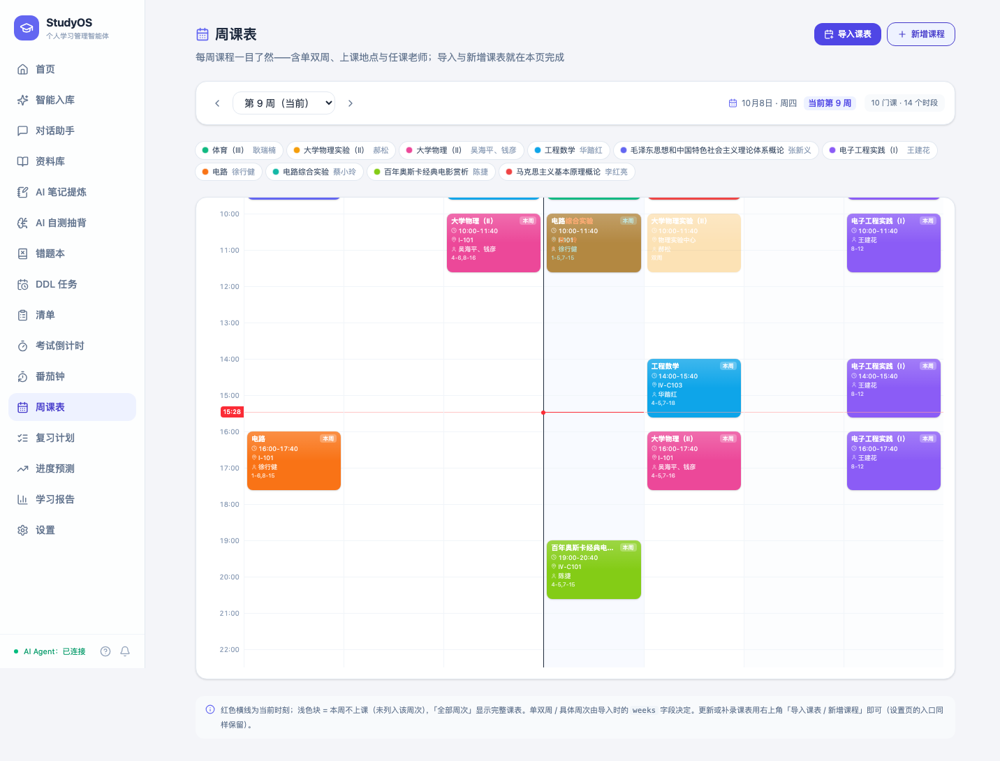
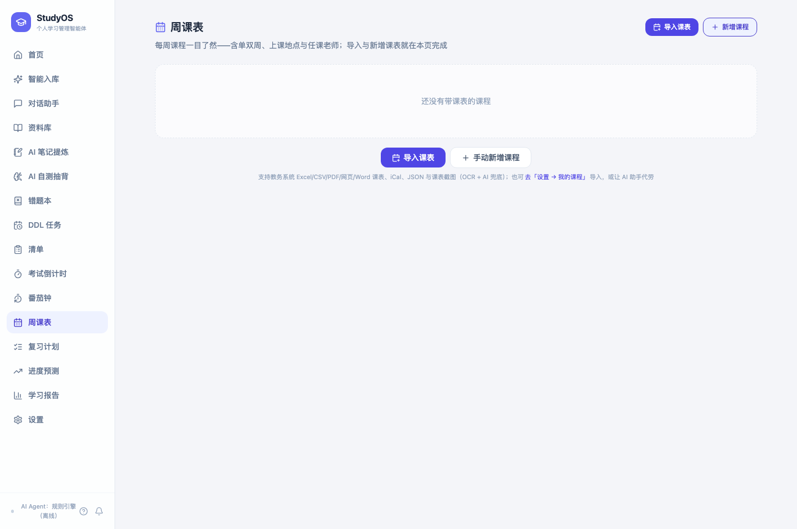
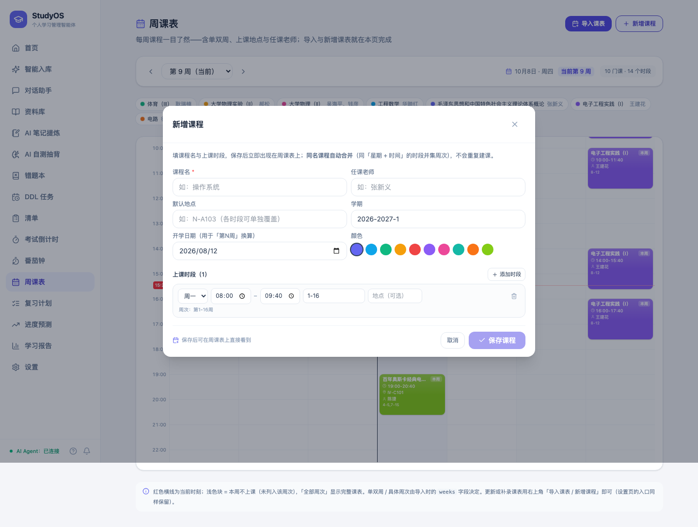
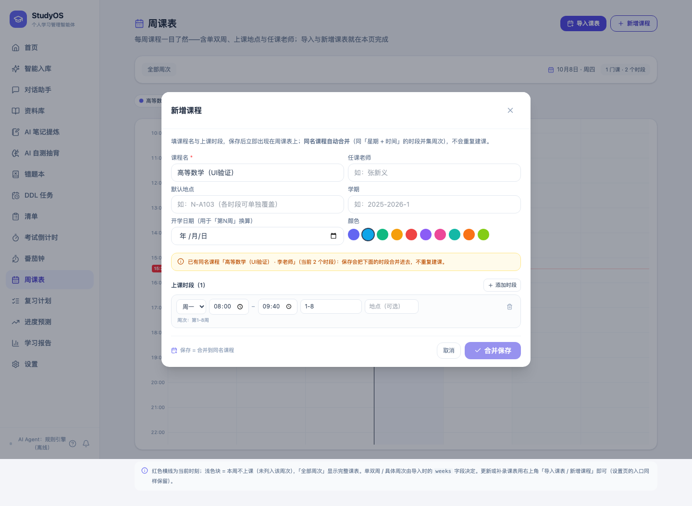
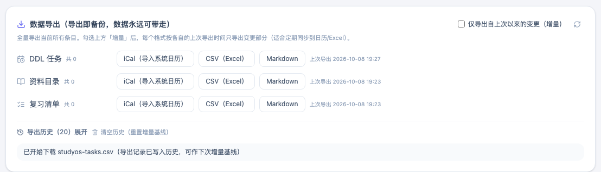
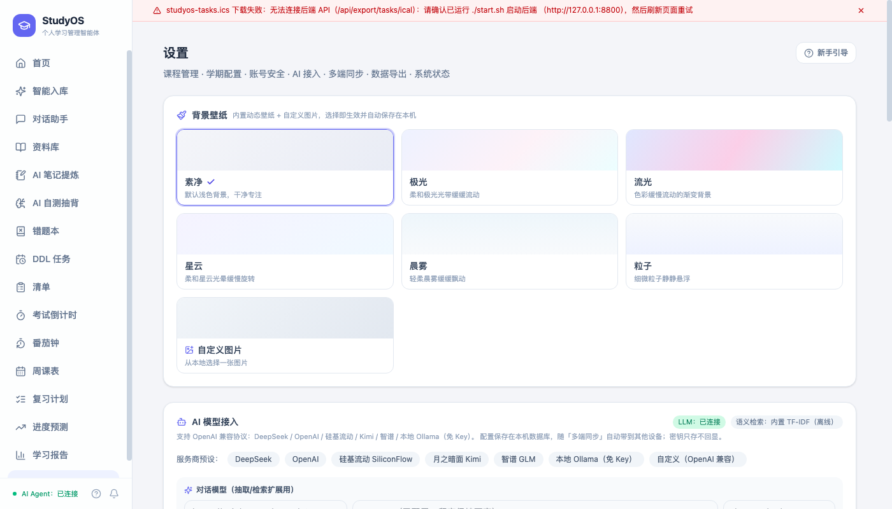

# StudyOS · 面向学生的个人学习管理智能体

> 校园生活赛道作品。围绕「课程资料整理 · 学习任务管理 · 截止日期提醒 · 复习计划生成」，
> 构建**清晰、可检索、可提醒**的个人学习管理闭环。

## 功能总览

| 场景 | 能力 |
|---|---|
| 资料入库 | 粘贴文本 / 拖拽文件 / 上传截图（OCR），自动抽 DDL 与标签；**常见文件格式全覆盖（110 种扩展名 / 12 个分组）**：文档（PDF·Word·旧版 .doc·ODT·RTF·TXT·Markdown·LaTeX）、表格（Excel·.xlsm·.xls·ODS·CSV·TSV，渲染成带表头的表格文本）、演示（PPTX·.ppt·ODP，含表格/图表/演讲者备注）、电子书（EPUB·MOBI/AZW3）、Jupyter Notebook、网页 HTML、结构化数据（JSON·YAML·XML·ICS）、字幕听记（SRT·VTT·ASS·LRC，保留时间戳）、代码与脚本（34 种，附顶层定义摘要）、压缩包（**ZIP·TAR·tar.gz·tgz·tar.bz2·tbz2·tar.xz·txz·gz·bz2·xz 自动展开包内可解析文档**，包内套包只展开一层、系统元数据自动跳过；7z·rar·dmg·zst 明确提示「先用工具解压再上传」）、图片 OCR（PNG·JPG·WEBP·BMP·GIF·TIFF·AVIF 等）；**格式按文件内容嗅探**（魔数 + 容器内部结构，不信任扩展名：改名成 .ppt 的 PPTX、无扩展名的教务导出、伪装成 .txt 的网页都能纠正，扩展名与内容不符会明确提示）；中文编码自动识别（UTF-8/GB18030/Big5/Shift-JIS/EUC-KR，简繁互误用常用字打分纠正）；扫描版 PDF 自动栅格化后 OCR；上传即可见「格式徽标 + 抽取 N 字 + 抽取原文」 |
| 导入课表 | **周课表页右上角「导入课表」/「新增课程」**（设置 → 我的课程 →「导入课表」原样保留，两处同一套接口与合并规则）：导入侧**八类来源全覆盖**——① 教务系统（正方/强智等）导出的 **Excel 二维课表**（.xlsx / 老式 .xls / .xlsm，按「一列一个星期 × 一行一个节次」解析，自动抽取课程名/老师/地点/周次与单双周（行标签兼容「第1-2节」「08:00-09:40」与南理工等校的「第一大节…第五大节」，周次兼容 `1-16周`、`4-6,8-18[周]`、`6[周]`，老师职称括注自动剥离、罗马数字楼号识别为教室），多工作表取数据最多的那张）；② **CSV/TSV**（UTF-8/GB18030）；③ **ODS** 表格；④ **PDF 课表**（PyMuPDF 表格识别 → 词框坐标网格重建，多页合并；**扫描版无文本层的 PDF 自动栅格化后 OCR**）；⑤ **网页课表**（教务系统「打印」页另存为 .html，解析 `<table>` 并**展开 rowspan/colspan 合并单元格**）；⑥ **Word 课表**（.docx 表格）；⑦ 课表 App 导出的 **.ics** 与 **JSON**（iCal 周循环事件展开成周次、单双周/EXDATE 节假日自动排除、老师/地点从 LOCATION/DESCRIPTION 抽取；JSON 支持 `courses/slots` 与扁平 `course_list`，「第3-4节」按标准节次表换算、周次支持 `1-16单/双`）；⑧ **课表截图/照片**（PNG·JPG·WEBP·GIF·BMP·TIFF·AVIF，本地 OCR → 坐标网格重建 → 失败或漏节次列时自动走 **AI 智能兜底**，标识「AI 辅助」）；格式一律按**文件内容嗅探**（不信任扩展名，扩展名与内容不符会自动纠正并提示）；解析后**先预览**（周课表网格 + 勾选课程 + 来源格式徽标）再确认导入——新课程自动配色，**同名课程自动合并**不重复建课；开学日期按最早上课周自动推算，「第N周」类时间表达即刻可用；课表时段（星期/时刻/周次/地点/老师）随多端同步跨端迁移；**Agent 助手也可导入课表**：预览 → 确认执行 → 可撤销，与手动导入同一套合并规则；**手动补录同样在课表页**——「新增课程」填课程名/老师/地点/配色 + 多个上课时段（星期 · 起止时刻 · 周次 · 时段地点），周次写法当场回显人话（「1-16单」→「单周（第1-15周）」），课程名重复时给出提示并**合并保存**（不重复建课） |
| AI 笔记提炼 | 对任意资料全文或粘贴文本一键**提炼重点笔记 / 考点笔记**（结构化要点 + 重要度分级）；**文件提炼**：直接上传 **PDF / Word / Excel / PPT / ODT / 电子书 / 文本 / 图片**等（≤50MB，图片 ≤20MB）→ 复用「资料入库」同一套内容嗅探与抽取器（扫描版 PDF 自动转 OCR、板书照片走离线 OCR）→ 提炼笔记，抽取原文可核对、可修正后重提炼，切换模式无需重新上传；LLM 结构化提炼，未配置时自动降级**离线抽取式摘要**；笔记可编辑、可挂资料、可导出 Markdown，并进多端同步 |
| 结构化标签 | 课程 · 学期 · 资料类型 · **章节（独立字段）** · **难度（简单/中等/困难）** · **考试重点标记** + 关键词自动打标，人工可改，低置信必确认 |
| 检索 | 中文分词 + FTS5 全文检索 + 高亮摘录；**语义检索**（向量召回 + 同义词/LLM 查询扩展）与**混合检索**（RRF 融合全文 × 语义）；课程/类型/章节/难度/考试重点/**多标签**组合过滤**全部在 SQL 内完成**（标签走 `json_each`，分页与计数都在过滤之后，大库不丢结果） |
| DDL 提醒 | 默认提前 3 天 / 1 天 / 2 小时；**Web Push**（Service Worker push 订阅，页面关闭也能收到）+ 站内角标；手机 / 不支持的环境用 **iCal 导出**同步系统日历兜底 |
| 间隔重复 | 复习效果四档评分（忘了/吃力/正常/轻松）→ SM-2 变体调度：掌握度 0~1 实时更新、间隔 1→2→4→7→14→30 天阶梯、again 遗忘回退、到期队列（逾期标红）；复习计划按掌握程度加权分配时长、到期复习排前、首次学习预排 1/3/7 天检查点；状态随多端同步 |
| 番茄钟 · 专注计时 | 专注/短休息/长休息三阶段计时（基于结束时间戳，切后台也准确）；**可绑定 DDL 任务、课程或复习计划的某天复习块**（复习页每个复习块一键「开始专注」直达）；专注记录**后端 SQLite 持久化**（换浏览器不丢，旧版本地统计一键迁移合并）；统计：今日番茄/专注分钟、**连续专注天数**、近 7 天柱状图、**课程分布**、专注时间线（可删）；番茄工作法配套——「记录打断」计数、放弃的番茄不计入番茄数但时间留痕；专注完成后**直接给复习块内资料评分**（忘了/吃力/正常/轻松），喂回间隔重复掌握度；复习计划页每个复习块显示「已专注 X 分钟」；阶段结束提示音 + 可选桌面通知；首页展示今日专注与连续天数 |
| 错题归集 | 把试卷/作业里做错的题归集进**错题本**（题目/我的答案/正确答案/错因分析 + 课程/章节/难度/标签/来源），支持**AI 提炼**——粘贴错题原文，LLM 自动补全标题/题目/答案/错因/章节/难度/标签（未配置 Key 时降级离线规则引擎，只填不编造）；章节与难度按「标题 + 题干」**自动规则抽取**（与资料归档同一套引擎，可手动修正）；组合过滤（课程 × 章节 × 难度 × 状态 × 多标签 any/all）+ 关键词检索；**重练模式**随机抽「待攻克」错题自评——连续答对 2 次自动「已掌握」、答错清零回退；单条/全量 Markdown 导出；错题与重练记录随多端同步快照跨端迁移 |
| AI 自测 / 抽背 | 基于**笔记 / 资料全文 / 任意文本**一键自动出**选择题与问答题**（来源四选一：按课程自动取该课笔记（无笔记回落资料全文）/ 指定资料 / 多选笔记合并 / 自由粘贴文本，笔记页卡片可直接「抽背」跳转）；**双引擎出题**：LLM 结构化出题（4 选项选择题 + 问答题 + 解析，忠于原文不编造），未配置 Key 或失败自动降级**离线规则引擎**（挖空选择题——关键术语做干扰项 + 「什么是 X」定义题 + 要点回忆题，断网可用、演示不崩）；选择题**服务端自动判分**即时反馈解析，问答题先回忆默写 → 对照参考答案 → **自评「记住了/没记住」**；作答记录全程留痕（可继续/重做/复盘），组统计（选择题正确率 / 问答通过率 / 按课程分布）联动首页；单组/全量 Markdown 导出；自测组随多端同步跨端迁移（课程/资料/笔记引用按 uuid 重映射） |
| 复习清单 | 选考试 → 自动生成每日复习块：DDL 倒排 + 资料量 × 难度权重 × 考试重点 × **掌握程度加权**（未掌握 1.6×、已掌握 1.0×）；每份资料带 **间隔重复状态**（SM-2 变体：again/hard/good/easy 四档评分 → 掌握度 0~1、间隔 1/2/4/7/14/30 天阶梯、遗忘回退）；每天先排「到期的间隔复习」再排新学，首次学习自动预排 1/3/7 天检查点；到期复习队列、掌握度看板、评分入口都在复习页 |
| 清单 · 模版库 · 分享链接 | 通用勾选清单（标题/描述/课程/标签/截止日 + 可勾选项，进度环展示，单条可导出 Markdown）；**模版库**：13 个内置学生模版（期末复习/考前冲刺/四六级备考/论文写作/开学准备/每周学习计划…，随版本升级自动扩充修订）+ 用户把清单「存为模版」或自建模版（可编辑可删除，内置模版只读受保护）；选模版一键**复制生成新清单**，改动不回流模版；**分享链接**：生成只读链接给同学查看（可选过期/随时撤销/查看计数），查看端勾选进度只保存在自己浏览器、绝不写回分享者数据；StudyOS 用户可**一键导入**（服务端抓取 + 课程按名匹配 + 勾选清零），或下载 JSON 手动导入 |
| 进度预测 · 负载预警 | 对每场考试按 **DDL 倒排 + 剩余学时 ÷ 剩余天数** 预测能否按时学完（进度良好/偏紧/预警），顺序仿真给出**预计完成日期**与**考试日预计掌握度**，输出逐日掌握度曲线；未来 N 天逐日负载 = DDL 截止权重 + 复习计划学时 + 到期复习，超容量 100%/150% 预警偏满/超载，并识别**连续高负载**与**考试撞车**；近 7 天实际节奏 vs 所需节奏对比；与复习计划共用同一套时长公式、口径一致 |
| 多格式导出 | DDL / 复习清单 / 资料目录 → **iCal · CSV · Markdown**；资料目录 iCal 为真 iCal（入库时间线全天事件）；支持**增量导出**（只导出自上次以来的变更，按「类型 × 格式」各自维护基线）+ 导出历史可查可重置 |
| AI 模型接入 | 设置页可视化配置 LLM/Embedding（DeepSeek·OpenAI·硅基流动·Kimi·智谱·本地 Ollama），Key 只存不回显、**改完即生效无需重启**、一键连通性测试，未配置自动降级离线引擎 |
| 多端同步 | 两台设备点对点直连一键同步（设备令牌配对，Last-Write-Wins 冲突解决，资料文本+附件文件一并互传）；令牌默认**掩码 + 指纹**展示、明文需本机显式确认；**完整备份 zip** 导出 / 恢复，换设备零成本 |
| 账号 · 登录保护 | **本地账号体系**（用户名 + 密码，PBKDF2-SHA256 加盐哈希，库里只存哈希）：注册 / 登录 / 登出、修改密码（其它会话即时失效）、成员账号管理（添加/删除）；**「登录保护」开关默认关闭**——保留零注册即用体验，开启后除公开分享/健康检查外的 API 与页面都需登录（Bearer 会话令牌，30 天有效 + 活跃滑动续期）；**登录防爆破**（按用户名 × IP 连续失败指数退避锁定）+ 开放注册限速 + **安全事件审计**（登录成败/注册/改密/开关保护/账号与会话管理全程留痕）+ **登录会话管理**（查看设备/撤销会话/一键退出其它设备）+ **忘记密码恢复工具**（`python -m app.authadmin`）；账号只存本机（**不进同步快照、不进完整备份**），全部账号共享同一份学习数据——登录即本机访问锁 |

**核心链路**：资料入库 → 结构化标签 → 检索 → 笔记提炼 → 提醒 → 复习清单 → 错题归集重练 → **自测抽背** → **番茄钟专注（挂复习块 → 完成即评分）** → 导出，一次入库全链路打通。

## 目录结构（先看这一节再找文件）

```
StudyOS/
├── README.md · LICENSE · .gitignore · .gitattributes · .editorconfig · .env.example
├── scripts/        一键启动与构建（start.bat · start.sh · stop.bat · stop.sh · build-release.ps1）
├── release/        交付产物区：StudyOS-Windows-x64.zip + SHA256SUMS.txt（不进版本库）
├── docs/           技术文档 · 用例集 · 合规说明 · 提交材料清单 · 需求分析 · 开发记录 · 验收截图
├── backend/        FastAPI 后端：app/{api,domain,infra} 三层分包 + tests + scripts
├── web/ mobile/    双端前端：src 源码 + dist 预构建产物
└── logs/           运行日志（.gitkeep 占位）
```

**源码与产物分界**（改东西前请先确认自己在动哪一边）：

- **产物区**：`release/`（交付归档，整体 gitignore，由 `scripts/build-release.ps1` 生成）；
  `backend/.venv`、`node_modules/`、`backend/data/`、`logs/*`（本地环境与运行数据）。
- **必须是产物但随包交付**：`web/dist`、`mobile/dist` —— 后端 `app/api/main.py` 直接托管
  `web/dist`，删掉后界面 404（接口仍正常，不易发现）。`.gitignore` 末尾已显式保护，**请勿删除**。
- **后端分层**：`app/api` 只放 HTTP 接口（路由、鉴权、DTO），`app/domain` 放业务规则
  （同步、复习调度、出题、预测、导入解析），`app/infra` 放基础设施（配置、数据库、模型、
  文件、抓取、推送）。新代码请按这一分工落位，不要在 `app/` 根下新增平铺模块。
- 兼容性保留：`app/authadmin.py` 是薄壳，`python -m app.authadmin ...`（命令行找回账号）
  仍然可用，等价写法是 `python -m app.api.authadmin ...`。

## 快速开始

```bash
# 1. 后端（自动创建 venv、安装依赖、启动 :8800）
./scripts/start.sh -d  # 推荐：后台常驻，关掉终端也不停
./scripts/stop.sh      # 停止

# 2. 打开
open http://127.0.0.1:8800

# 3.（可选）灌入演示数据
cd backend && .venv/bin/python scripts/seed.py
```

后端两种启动方式，按需选：

| 命令 | 行为 | 停止方式 |
| --- | --- | --- |
| `./scripts/start.sh` | 前台运行，日志直接打在终端 | `Ctrl+C`；**关掉终端窗口后端也会停** |
| `./scripts/start.sh -d` | 后台常驻（nohup 脱离终端），日志落盘到 `logs/` | `./scripts/stop.sh` |

后台模式的运行状态：PID 在 `logs/studyos.pid`，日志在 `logs/backend.out.log`（标准输出）与
`logs/backend.err.log`（错误输出），实时查看用 `tail -f logs/backend.out.log`。

两个脚本都是**幂等**的：重复 `./scripts/start.sh` 只提示「已在运行」而不会起第二个实例；
`./scripts/stop.sh` 在没运行时也会正常退出。`stop.sh` 会先校验目标 PID 确实是本项目的
uvicorn（且确实在监听 8800）再动手，先 `SIGTERM` 优雅退出，超时才 `SIGKILL`，
避免误杀同名进程或留下半死不活的实例。

前端已构建于 `web/dist`，后端直接托管，单端口即用。开发模式（HMR）：

```bash
cd web && npm install && npm run dev   # :5173，代理 /api 到 :8800
```

## 环境要求与部署

### 运行环境

| 项 | 要求 | 说明 |
| --- | --- | --- |
| 操作系统 | Windows 10/11 · macOS 12+ · Linux（含 WSL） | 本仓库的验证环境为 Windows 11 + PowerShell |
| **Python** | **3.10 及以上**（已在 3.14 上验证） | 唯一必需的前置依赖；启动脚本会自动定位 `py -3` / `python` / `python3` |
| Node.js | **仅在修改前端源码时需要**（18+） | 仓库已含 `web/dist`、`mobile/dist` 构建产物，直接使用**不需要** Node |
| 浏览器 | Chrome / Edge / Safari / Firefox 现代版本 | Web Push 与离线 PWA 需支持 Service Worker 的浏览器 |
| 网络 | **非必需** | 仅首次安装依赖需要网络；未配置大模型 Key 时全功能离线可用 |

### 依赖安装

**方式一：交给启动脚本（推荐，零手工步骤）**

`scripts/start.bat` / `scripts/start.sh` 首次运行时会自动：创建 `backend/.venv` → 按 `backend/requirements.txt` 安装依赖
→ 校验 pip 是否存在（缺失时用系统 pip 注入）→ 启动服务。OCR 组件（`rapidocr-onnxruntime`）装不上时**只告警不中断**，
其余功能照常可用。

**方式二：手工安装**

```bash
cd backend
python -m venv .venv
.venv/bin/python -m pip install -r requirements.txt        # 直接依赖（版本锁定）
.venv/bin/python -m pip install -r requirements.lock       # 需要精确复现时（含全部传递依赖）
.venv/bin/python -m uvicorn app.api.main:app --host 0.0.0.0 --port 8800
# Windows 用 .venv\Scripts\python.exe
```

### 启动命令与运行方式

| 命令 | 行为 | 停止方式 |
| --- | --- | --- |
| `scripts\start.bat`（Windows 双击） | 建环境 → 装依赖 → 启动 → 打开浏览器 | 关窗口 / `Ctrl+C` |
| `./scripts/start.sh` | 前台运行，日志直接打在终端 | `Ctrl+C`；**关掉终端后端也会停** |
| `./scripts/start.sh -d` | 后台常驻（nohup 脱离终端），日志落 `logs/` | `./scripts/stop.sh` |
| `./scripts/stop.sh` | 停止后台实例（先校验 PID 确实是本项目的 uvicorn 再终止） | — |

后台模式的运行状态：PID 在 `logs/studyos.pid`，日志在 `logs/backend.out.log` 与 `logs/backend.err.log`，
实时查看用 `tail -f logs/backend.out.log`。启动脚本**幂等**：已在运行时只提示并复用，不会起第二个实例。

- 访问地址：**http://127.0.0.1:8800**（后端同时托管前端，单端口即用）
- 局域网演示：启动脚本会打印 `http://<局域网IP>:8800`，同一 Wi-Fi 的手机可直接打开
- 接口文档：http://127.0.0.1:8800/docs
- 演示数据：`cd backend && .venv\Scripts\python.exe scripts\seed.py --reset`
  （`--check` 只体检、`--dry-run` 只打印、`--base` 换地址；数据全为合成内容，可随时删除）
- 换端口：`backend/.venv/Scripts/python.exe -m uvicorn app.api.main:app --port 8900`（同步改 `seed.py --base`）

## 常见问题（FAQ）

| 现象 | 原因 | 处理 |
| --- | --- | --- |
| 双击 `scripts\start.bat` 后窗口一闪而过 | 未安装 Python，或安装时未勾选「Add python.exe to PATH」 | 安装 Python 3.10+（勾选 Add to PATH）后重试；脚本找不到 Python 时会打印下载地址并暂停 |
| 提示 `No module named pip` | 个别 Python 构建的 `ensurepip` 不可用，venv 里没有 pip | 升级版启动脚本会自动用系统 pip 注入；仍失败则修复 Python 安装 → 删除 `backend\.venv` → 重新运行 |
| `[Errno 10048] 端口 8800 已被占用` | 已有一个 StudyOS 在跑，或被其它程序占用 | 脚本会先做健康检查并复用已在运行的实例；确需换端口见上一节「换端口」 |
| macOS 上把 Windows 拷来的 `.venv` 直接用 | venv 不可跨平台（`Scripts\` vs `bin/`，`pyvenv.cfg` 指向原路径） | 删除 `backend/.venv` 后重新运行 `./scripts/start.sh`（`scripts\start.bat` 也会自动识别并重建） |
| 依赖装不上（`pip install` 报网络错误） | 校园网/公司网需要代理，或离线环境 | 配好 pip 代理后重试；离线环境可用 `requirements.lock` 从本地 wheel 源安装。**注意**：本机/内网服务不会被系统代理截走（见「提交前自检修复」） |
| OCR 组件安装失败 | `rapidocr-onnxruntime` 对部分 Python 版本没有预编译包 | 不影响其它功能：截图/课表照片识别会提示「改用文字版或把文字粘贴进来」；需要 OCR 时升级到 Python 3.10+ 重跑启动脚本 |
| 上传扫描版 PDF 后「抽不到文本」 | 文件是图片型 PDF，且本机没有可用 OCR | 安装 OCR 组件，或改用文字版 PDF，或把关键内容粘贴为文本再提炼 |
| 开启「登录保护」后自己进不去了 | 忘记密码，且应用内故意没有在线重置入口（防绕过） | 本机命令行恢复：`cd backend && .venv\Scripts\python.exe -m app.authadmin reset-password <用户名>`；也可用 `disable-protection` 关闭保护、`list-users` 查看账号 |
| 点「数据导出」没反应 | 后端未启动，或 Service Worker 缓存了旧版本 | 界面会给出「无法连接后端 API…请确认已运行 ./scripts/start.sh」横幅；刷新页面（或注销 SW）后重试 |
| 收不到 DDL 推送通知 | 浏览器未授权通知、非 HTTPS 环境（局域网 IP 访问）、或系统通知被关闭 | 用 iCal 兜底：设置页导出 `.ics` 导入手机/电脑日历（带提前提醒） |
| 局域网其它设备打不开 | 系统防火墙拦截了 Python 入站，或不在同一网段 | 放行 Python 的专用网络入站；用脚本打印的 `http://<局域网IP>:8800` 访问 |
| 界面提示「扩展名与内容不符」 | 文件被改过后缀（如 PPTX 改名成 `.ppt`） | 属正常提示：系统按**内容**解析并已成功抽取，无需处理 |

## 依赖锁定（保证团队 / 换机 / 答辩环境可复现）

- `backend/requirements.txt`：直接依赖，**全部 `==` 锁定精确版本**（scripts/start.bat / scripts/start.sh 首次运行即按此安装）
- `backend/requirements.lock`：完整锁定文件（含全部传递依赖），**精确复现**用：
  ```bash
  cd backend && .venv/bin/python -m pip install -r requirements.lock
  ```
- 依赖变更后同步更新锁文件：`.venv/bin/python -m pip freeze > requirements.lock`
- 测试依赖：`backend/requirements-dev.txt`（`pytest==9.1.1`）

## Agent 核心增强与正式接入（2026-10-03）

已恢复缺失的 `backend/app`，并把核心接入正式 FastAPI 应用的登录、全文/语义检索、Web Push 调度和多端同步。双端 `/assistant` 支持多轮历史、资料/任务/复习/专注联动、延期原任务、关联重排预览和操作撤销。

写请求与离线队列持久保存，支持跨设备 JSON 导入导出、原请求键重试、UUID 收敛及同步回执；附件须重新上传，计划变更继续预览后确认。后端 **323 项**、Web/Mobile 各 **51 项**测试通过，双端生产构建成功。

真实设备推送送达、外部模型和联系人验证服务仍需实际配置与联调；对话暂未同步到独立服务器。当前边界、启动方式和检查证据见 [增强与接入记录](docs/AGENT_CORE.md)，早期前端记录见 [Agent 入库增强记录](docs/AGENT_HARDENING.md)。

## 核心 Agent 强化（第二轮）：课表与学习文件格式全覆盖（2026-10-07）

本轮强化核心 agent 的两件日常重活：**课表导入**与**学习文件上传识别**。

**学习文件上传识别：常见格式全覆盖（110 种扩展名 / 12 个分组）**

- 新增 `backend/app/ingest/formats.py` 作为**唯一事实来源**：每个扩展名登记分组（文档·演示·表格·电子书·代码笔记本·网页标记·结构化数据·代码脚本·字幕听记·图片·压缩包·音视频）、中文名、抽取 kind、是否走 OCR、备注；`GET /api/ingest/formats` 把它暴露给双端——上传 `accept`、格式矩阵面板、格式徽标、摘要文案全部由它派生，后端加一种格式两个前端不必各改一遍字符串；本机能力不足的格式（缺 HEIC 解码器、音视频不转写）**降级标记 + 给替代做法**，不承诺做不到的事。
- 抽取能力从「PDF·PPTX·DOCX·TXT」扩到：Word（正文 + 表格 + 页眉页脚，按文档顺序交错）、PPT（文本框 + 表格 + 图表数据 + **演讲者备注**）、Excel/ODS（逐工作表渲染成带表头的表格文本，日期不丢）、旧版 `.doc/.ppt`（OLE2 容器有界文本抓取 + 「建议另存为」提示）、ODT/ODP、RTF（`\'hh` 十六进制与 `\uN` 转义、字体表/颜色表跳过）、EPUB（按 OPF spine 顺序）、MOBI/AZW3（PalmDOC LZ77 解压）、Jupyter Notebook（Markdown + 代码 + 文本输出）、网页 HTML、JSON/YAML/XML、CSV/TSV、字幕 SRT/VTT/ASS/LRC（**保留时间戳**，便于把考点定位到视频位置）、34 种代码文件（附顶层定义摘要）、压缩包（**ZIP / TAR / tar.gz / tar.bz2 / tar.xz / 单文件 gz·bz2·xz** 有界展开包内可解析文档，tar 家族流式读取不整包进内存）。
- **格式按内容判定**：魔数 + 容器内部结构（OOXML/ODF/EPUB 靠 ZIP 内部结构、doc/xls/ppt 靠 OLE2 流名、图片/音视频靠文件头），扩展名与内容不符时**按内容解析并明确提示**；改名成 `.ppt` 的 PPTX、教务系统导出的无扩展名文件、伪装成 `.txt` 的网页都能纠正。
- **中文编码自动识别**：UTF-8/GB18030/Big5/Shift-JIS/EUC-KR/CP1252 编码阶梯。GBK 与 Big5 会**互相把对方的字节解成合法汉字**，用「常用汉字打分」纠正（简繁/日/韩/西欧 9 类语料实测全部正确），非 UTF-8 会提示实际编码。
- **扫描版 PDF 自动 OCR**：文本层不足阈值时按上限（前 10 页 / 180 DPI）栅格化后逐页 OCR，临时文件必定清理；OCR 不可用时给「改用文字版 PDF」的中文指引。
- **健壮性**：大文件按字节上限读取（上传上限 512MB 也不会整载入内存）、按字节截断不会把末尾半个汉字误判成乱码（增量解码器）、压缩包按「条目数 × 单条体积 × 解压总量」三重上限展开且嵌套包只展开一层（防 zip 套 zip 指数放大），加密/超限条目跳过并说明原因。

**课表导入：八类来源全覆盖**

- 新增 **PDF 课表**（PyMuPDF 表格识别优先，失败则用词框坐标重建网格，多页合并；扫描版自动 OCR）、**网页课表**（解析 `<table>` 并展开 rowspan/colspan 合并单元格——教务系统打印页大量使用）、**Word 课表**（.docx 表格，无表格时按段落成列）、**ODS 表格**（展开 `number-columns-repeated` 且有上限）四类来源，图片扩展 GIF·TIFF·AVIF，`.json` 文件直传。
- 所有来源统一还原成「行 = 节次 / 列 = 星期」的字符串网格，再走同一套解析（星期表头定位列、节次/时刻标签定位行、单元格内就地抽取课程名/周次/单双周/老师/地点），因此**新增来源不会各写一套解析逻辑**。
- 预览新增 `format_label`（「PDF 课表」「网页课表」「ODS 课表」「课表截图（AI 辅助）」…），双端课表导入的 `accept` 与提示文案同步扩展。
- 顺手修掉一处真实缺陷：OCR/PDF 共用的「同一格错行合并」逻辑纯按距离判定，**表头比数据行挨得更近时会把「周一…周日」并进第一行**，星期列消失、整份课表直接解析失败（教务系统紧凑排版常见，实测表头距首行 60pt、行距 100pt 时 100% 触发）；现在含 ≥2 个星期名的行永不参与行合并（表头是网格的列定义），并补了「几何单元 + PDF 接口」两层回归用例。
- **Agent 也能导入课表**：`agent_core/courses.py` 把已解析的课表条目变成**事务化建议**——逐门判定「新建 / 按名合并」（合并口径与宿主一致：同 `weekday+start+end` 并集 weeks，其余字段只补空不覆盖）、扫描并提示时间冲突（只提示不阻塞）；`POST /api/agent/courses/preview` 预览 → `POST /api/agent/plans/{id}/apply` 单事务落库（幂等键 + 回执重放）→ `POST /api/agent/operations/{id}/undo` 撤销。新增「新建行执行时必须仍然不存在」的并发保护：两个预览都判「新建」同一门课时，后执行的 409 重新生成，而不是插入重复课程；能力位见 `/api/agent/capabilities` 的 `course_import`。

**回归结果**：后端 **625 项**通过（本轮新增 257 项：格式登记与内容嗅探 115、上传格式矩阵 22、抽取引擎边界与降级 31、Agent 课表事务 45、课表新来源 39、既有课表与网格用例追加 5）；Web / Mobile 各 **77 项**通过，双端生产构建成功。

实现细节、接口契约与已知边界见 [课表与格式全覆盖记录](docs/AGENT_INGEST.md)。

## 课表导入强化（第三轮）：南理工等教务系统版式（2026-10-08）

实测南京理工大学导出的「学生个人课表」(.xls) 报「没找到节次/时间列」而完全导不进来。该版式与既有用例的形状不同，暴露了五处真实缺陷，逐个修掉后整份课表 10 门课全部正确入库：

- **「大节」行标签**：教务系统按「第一大节…第五大节」分行（没有时刻列、也没有「第1-2节」）。新增 `_MAJOR_PERIODS` 把大节映射到标准 12 节时间表（1-2 / 3-4 / 5-6 / 7-8 / 9-10 节，第五大节 = 晚上 19:00-20:40），行标签、时刻列判定、`_count_time_marks`（左标签列识别）三处一起认，既不会漏时间，也不会把「第一大节」当成一门课。
- **`4-6,8-18[周]` 周次写法**：周次写在方括号里、逗号串多段，旧正则只吃到第一段（把一门课的周次砍成半截）。重写周次提取为**手写扫描**（先定位「周」字，再往左按逗号分段校验、往右取「(单)/(双)」），支持 `[周]`/`（周）`/`1-16周(单)`/`1,3,5-8周` 等全部写法，并带「周次本体必须是数字/逗号/连接号」「越界不当周次」的校验——「教3-101周」这种房间号加周字不会被误认成周次。
- **教师职称括注**：老师行写成「张新义(讲师)」「吴海平(副教授),钱彦(副教授)」，旧逻辑会把「张新义(讲师)」整串入库、甚至因为「像课名」而另起一门课。现在按「最后一个职称括注之前、最后一个分隔符之后」切出姓名并去掉职称括注，多名教师逐个从右往左剥（`吴海平、钱彦`）；「体育（Ⅲ）」这类课名自带括号的写法不受影响。
- **罗马数字楼号**：南理工教室是「Ⅳ-A103」「I-101」（全角/ASCII 罗马数字混用），旧规则只认「A201/205」形态，于是教室号被当成课程名。`_looks_like_location` 增加罗马数字楼号与「物理实验中心/XX中心」这类无门牌号场所；顺带排除 4 位年份（表头里的 2026 不再被当教室）。
- **一格里塞两门课**：同一时段的第二门课用**空行**与上一门隔开（「大学物理实验（Ⅱ）/郝松()/…/物理实验中心」空行「马克思主义基本原理概论/…」）。旧逻辑按「课程名行」分块，而「郝松()」「物理实验中心」本身就像课名，一门课被拆成三门且元数据互相污染。现在空行是**硬分块边界**（`[\n\r]+` 会把空行一起吃掉，得逐个换行切），每块只取自己的老师/地点/周次行；块内还有别的课名行时，纯姓名行（「郝松」）一律当附属行，不另起一门。
- **紧凑学期写法**：「学年学期：2026-2027-1」这种不带「学年第一学期」字样的表头现在也能识别。

**回归结果**：后端 **632 项**通过（本轮新增 7 项回归，覆盖大节换时刻、`[周]` 周次、职称剥离、罗马数字教室、空行分课、紧凑学期与「BIFF8 .xls 全链路」；并修正了 `_split_course_text` 与 `_looks_like_course_line` 之间的递归调用）。真实文件实测：10 门课 / 17 个时段，课程名、老师、地点、周次逐格核对无误。

> **已知边界**：「第N大节」按标准 12 节时间表换算（第五大节 = 第 9-10 节 19:00-20:40）。个别学校一天排到第 12 节（晚上两段），此版式本身不带时刻，若与实际作息有出入可在导入预览里改时段。

## AI 笔记提炼强化（第四轮）：PDF / Word / Excel 等文件直接提炼（2026-10-08）

「AI 笔记提炼」原来只有两条入口：粘贴文本、上传图片 OCR。学生手里更多的是**课件与讲义文件**
（PDF 讲义、Word 笔记、Excel 复习提纲、PPT 课件），本轮把这条链路接上，并让「识图提炼」与
「文档提炼」共用同一条抽取管线——**新增格式不再需要在笔记侧改代码**。

- **新入口 `POST /api/notes/refine-file`**：multipart 上传任意文件 → 落盘（边读边卡上限：文件 ≤50MB、图片 ≤20MB）→ `formats.detect_format` 按**内容**判定真实格式 → `files.extract_file` 抽正文（PDF / Word / Excel / PPT / ODF / 电子书 / 文本 / 压缩包 / 图片 OCR 全部复用资料入库那一套抽取器，扫描版 PDF 自动栅格化 OCR）→ 同一提炼管线（`agent/refine.py`：LLM 优先、离线规则降级）。**改名的课件（.ppt 实际是 PPTX）、无扩展名的导出文件照样能解析**，扩展名与内容不一致会在 `warnings` 里说明。
- **回包带全格式元信息**：`file_ext / format_label / format_group / format_group_label / source_kind(image|document) / text_chars / truncated / warnings[]`，以及截断到 2 万字的 `source_text`——前端据此渲染格式徽标、抽取提示与「核对原文 / 修正原文」，切换重点/考点模式直接用原文重新提炼，**不重复上传与识别**。
- **拒绝路径给下一步动作**：音视频 → 「本机不联网、不能离线转写，可上传配套课件或把文字粘贴进来」；认不出的类型 → 转 PDF/TXT 指引；空文档 → 区分「扫描件没文本层」与「空文件/正文都是图片」；解压炸弹像素、超大文件、OCR 未就绪各自 413/422 明确说明。
- **`/refine-image` 保留为图片专用兼容入口**（拒绝文档并提示改用文件提炼），老前端与外部调用方行为不变；两者现在共用同一份实现与同一份提示口径。
- **前端**：`ImageRefinePanel` 升级为 `FileRefinePanel`（Web / Mobile 双端同源）——拖拽 / 点击 / Ctrl+V 粘贴截图，图片显示缩略图、文档按分组显示图标与**后端嗅探出的中文格式名**，结果区展示抽取提示（扫描件 OCR / 扩展名不一致 / 原文截断）并可展开核对原文；可选格式由 `GET /api/ingest/formats` 新增的 `refine_accept` 派生（**剔除音视频与认不出的类型**，接口不可用时回落到提炼专用兜底目录，Excel 等主推格式不会因一次请求失败而消失）。
- **不做的事**：音视频不进提炼通道（本机无语音识别）；文档不做「摘要之外的改写」，抽取原文可核对可修正，避免把识别错误写进笔记。

**回归结果**：后端 **655 项**通过（本轮新增 23 项：文档提炼 21、格式登记与提炼 accept 2；另有 6 项识图提炼用例改为共用管线），Web / Mobile 各 **83 项**通过（新增 6 项格式派生与拦截理由用例），双端生产构建成功；真实文件实测 PDF / Word / Excel / 板书照片四条路径（含扫描件降级与拒绝路径），GUI 端到端上传—提炼—保存复核通过。

实现细节与接口契约见 [笔记文件提炼记录](docs/NOTES_FILE_REFINE.md)。

## 课表页直接导入 / 新增课表（2026-10-08）

「导入课表要先去设置页」这一步被去掉了：**周课表页右上角现在有「导入课表」与「新增课程」两个入口**，
空课表时页内同样给出这两个按钮；**设置页的「我的课程 → 导入课表」原样保留、未做任何改动**，
两处入口调用同一套接口与合并规则，互不依赖。

- **导入课表（本页）**：直接复用设置页那个 `TimetableImport`（文件 / 拖拽 / 粘贴 / 课表截图 → 解析预览 → 勾选确认），
  走同一个 `POST /api/courses/import/preview` + `POST /api/courses/import`；导入完页面就地刷新课表网格，不用来回跳转。
- **新增课程（本页）**：课程名 / 任课老师 / 默认地点 / 学期 / 开学日期 / 配色（与导入同一套 10 色调色板）
  + **多个上课时段**（星期 · 起止时刻 · 周次 · 时段地点）；周次支持 `1-16`、`1-16单`、`1-16双`、`1,3,5-8`、`第1-16周`，
  输入时**当场回显人话**（「单周（第1-15周）」），写法读不懂就地报错——脏数据进不了库。只填课程名也能保存（会说明「补时段后才出现在课表上」）。
- **同名课程自动合并**：课程名与已有课程一致时，表单顶部提示「已有同名课程「X · 老师」（当前 N 个时段）：保存会把下面的时段合并进去，不重复建课」，
  按钮变「合并保存」——同「星期 + 时间」的时段并集周次，其余追加，**与导入的合并口径逐字一致**
  （`parseWeeks` / `mergeSlots` 与后端 `courseimport.parse_weeks` / `merge_slots` 是同一套规则、同一批用例）。
- **不新增后端接口**：新建走 `POST /api/courses`、合并走 `PATCH /api/courses/{id}`（都早就在用），
  新增代码集中在 `web/src/components/CourseEditor.tsx` 与纯函数模块 `web/src/lib/courses.ts`（Mobile 同源同名文件）——
  课表页只挂两个按钮 + 两个弹窗，设置页一行未改。



空课表时不再只给一句「去设置导入」，页内就是完整入口（支持格式与设置页同一份说明）：



「新增课程」表单（课程基本信息 + 多时段 + 配色）与**同名课程的合并提示**：





**回归结果**：Web / Mobile 各 **94 项**通过（本轮新增 11 项：周次解析的单双周/乱序/边界/非法写法、时段合并的并集与不改原数组、调色板契约），
双端生产构建成功。无头 Chrome 端到端实跑「空课表 → 新增课程（2 时段，单/双周）→ 同名合并（时段 2→3，课程数不增）→ 本页导入课表 →
设置页入口回归」，逐步入库核对；再对**用户真实实例**只读复核一遍（页面渲染 + 两个弹窗可开可关，10 门课数据零变化）。
合并提示与表单细节见 [新增课程弹窗](docs/timetable-inline-add-course-verified.png)。

## 导出下载修复：点「数据导出」没有任何反应（2026-10-08）

**现象**：设置页「数据导出（导出即备份，数据永远可带走）」里点 iCal / CSV / Markdown，浏览器既不下载也不报错；
地址栏会变成 `127.0.0.1:8800/api/export/...` 但仍显示应用外壳，**后端日志里连这条请求都没有**（像没人点过一样）。

**根因**（两个问题叠在「下载 = 点链接直接导航」这一条路上）：

1. **Service Worker 的 SPA 回退把 `/api/*` 的导航也换成了 `index.html`**：`web/src/sw.ts` / `mobile/src/sw.ts` 里的
   `new NavigationRoute(createHandlerBoundToURL("index.html"))` 默认匹配**所有**导航请求，而 `<a href="/api/export/tasks/csv">`
   正是一次导航——请求在 SW 里就被截胡，永远到不了后端（PWA 离线可用与 Web Push 都靠这个 SW，所以不能简单去掉回退）。
2. **导航请求带不了登录令牌**：登录保护开启后 `/api/*` 一律要求 `Authorization: Bearer`，而 `<a href>` 这种浏览器原生导航
   加不了自定义头，只会把 401 的 JSON 当页面显示出来。

**修复**：

- **SW 回退放行 `/api/*`**：`NavigationRoute(..., { denylist: [/^\/api\//] })`——导出文件、报告/笔记 Markdown 照常打后端拿附件，
  其余路由的 SPA 回退、离线缓存与推送能力一律不变。
- **下载统一走 `fetch` + Blob**：`web/src/api.ts`（Mobile 同源）新增 `downloadFile()` / `saveBlob()` / `filenameFromResponse()`——
  带令牌请求 → 按 `Content-Disposition` 的文件名落盘；`path` 同时兼容 `exportUrl()` 这类带 `/api` 前缀的完整地址（不会再出现 `/api/api/...`）。
- **新增 `DownloadLink` 组件（双端同源）**：外观与普通链接一模一样，点击走上面的通道；仍保留 `href` + `download` 作为
  SW 尚未更新时的浏览器原生兜底。改造了**全部**下载入口：数据导出 9 个（3 类 × 3 格式）、推送卡片的「下载 iCal（兜底）」、
  学习报告 / 笔记（全部 + 单条）/ 自测（全部 + 单条）/ 错题本（全部 + 单条）/ 清单的 Markdown 导出。
- **失败不再静默**：导出卡片就地显示「导出失败（DDL 任务 · CSV）：…」；没有就地提示的入口由布局层弹红色横幅
  （后端没启动时直接给「请确认已运行 `./scripts/start.sh`」的指引），8 秒自动消失。同步的备份下载复用同一套落盘逻辑。

**验证**：无头 Chrome（真实 SW 生效）点完 9 个导出入口，9 个文件全部落盘——`studyos-tasks|materials|review` 的
`.ics/.csv/.md`，内容抽查 iCal `BEGIN/END:VCALENDAR`、CSV 表头 `ID,课程,任务`、Markdown 以标题开头，导出历史同步刷新为「上次导出 …」；
直接导航 `/api/export/tasks/md` 变成下载而不是 SPA 外壳（denylist 生效）；**停掉后端再点**，卡片内与全局横幅都给出
「无法连接后端 API … 请确认已运行 ./scripts/start.sh」，重启后端即恢复。**手机端同源改造后单跑一遍**（`WEB_DIST=mobile/dist` 另起 8801），
窄屏视口下 9 个导出入口同样全部落盘、文件名与桌面端一致。新增 5 项下载通道用例（文件名解析 / `/api/api` 归一化 / 404 抛出 / 不可达指引）双端各一份。





## 提交前自检修复：批量接口、代理拦截、启动与测试环境（2026-10-09）

为准备提交材料做了一遍「按文档核对实现」的自检，修掉 5 处**会让评审/答辩现场出问题**的缺陷：

- **资料批量操作接口缺失**：资料页的「批量删除 / 批量改标签 / 批量换课程 / 批量设置归档字段」调用
  `POST /api/materials/batch/{delete,tags,course,fields}`，而**后端没有这四条路由**——界面上点了没反应（404）。
  现按前端契约补齐（单事务落库、附件只删 `data/files` 内文件、同步失效 FTS 索引与语义缓存、
  删资料时一并清理间隔重复状态；未知 id 计入 `missing` 而不报错，跨设备同步/并发删除后可安全重试），
  新增 **18 项回归** `tests/test_material_batch.py`。
- **本机/内网请求被系统代理截走**：httpx 默认读 `HTTP_PROXY`/`ALL_PROXY`，用户机器上装过代理时，
  指向本机的调用会被代理接管——本地 Ollama 连不上、AI 连通性测试报「服务返回 503」而不是「无法连接」、
  局域网点对点同步与分享抓取同样受影响。新增 `app/netutil.py` 统一判定：**loopback / 私有网段 / `.local` 一律直连**
  （`trust_env=False`），公网服务仍沿用用户代理设置；已接入 LLM 通道、embedding 通道、AI 连通性测试、同步、分享抓取五处。
- **双击 `scripts\start.bat` 可能在「No module named pip」卡住**：部分 Python 构建的 `ensurepip` 不可用，
  `python -m venv` 建出的环境里没有 pip。启动脚本现在会自检 pip，缺失时用系统 pip 注入（`--python` 指向 venv），
  失败才提示修 Python；同时补上 README 里提到但**实际不存在**的 Windows 测试入口 `backend/scripts/test.bat`。
- **测试临时目录在受限环境不可用**：`tests/conftest.py` 与 agent 侧用例改为支持 `STUDYOS_TEST_TMP` 指定临时库根目录，
  并用 `makedirs` 建目录（`mkdtemp` 的 0o700 目录在部分 Windows 环境里连 SQLite 都建不了库）；
  没有创建符号链接权限的账户上，软链接逃逸用例**显式跳过并说明原因**，不再误报失败。
- **演示脚本不会用**：`scripts/seed.py` 增加 `--base`（换端口/地址）、`--reset`（重置演示环境）、
  `--check`（只体检不写入）、`--dry-run`（只打印动作），并先打印后端连通性、灌完复核数据量。

**回归结果**：后端 **727 项通过 + 1 项按环境跳过**（本轮新增 18 项批量操作 + 7 项代理判定；同步修正受影响的
三处 agent 临时库用例与同步用例），0 失败。交付材料见 [提交材料清单](docs/提交材料清单.md)、
[技术文档](docs/技术文档.md)、[用例集](docs/用例集.md)、[合规说明](docs/COMPLIANCE.md)。

## 测试（自动化回归）

当前后端回归为 **727 项通过 + 1 项按环境跳过**（Web 103 / Mobile 99 项）。测试使用临时数据；较早版本的历史用例数量不作为本轮验证结果：

```bash
cd backend && ./scripts/test.sh                 # 全量（当前 727 个用例）
cd backend && ./scripts/test.sh tests/test_notes.py -v   # 单模块/详细输出（如笔记提炼）
cd backend && ./scripts/test.sh tests/test_notes_file.py -v    # 文档提炼（PDF/Word/Excel 等）
cd backend && ./scripts/test.sh tests/test_notes_image.py -v   # 单模块/详细输出（如识图提炼）
```

Windows（PowerShell / CMD）等价入口：

```bat
cd backend
scripts\test.bat                      :: 全量（当前 727 个用例）
scripts\test.bat tests\test_notes.py -v   :: 单模块/详细输出
```

- **隔离安全**：测试使用临时数据库 + 强制离线规则引擎，绝不触碰 `data/studyos.db`、`data/files`，不依赖网络与 OCR 模型
- **当前覆盖**：课程/任务/资料、课表导入（八类来源 × 内容嗅探）、全文与语义检索、笔记、错题、间隔重复、复习与预测、导出、配置、同步及分享；新增核心幂等、持久回执、正式应用鉴权与索引、跨设备去重与回滚、延期/撤销、多轮对话、专注、自测和报告回归；本轮新增**资料批量操作（批量删除/改标签/换课程/改归档字段）、出站代理判定（本机与内网直连）**，以及此前几轮的**格式登记与内容嗅探、上传格式矩阵、抽取引擎边界（编码/压缩包/大文件/扫描 PDF 降级）、Agent 课表事务（含并发抢建 409）、课表新来源、笔记文件提炼（PDF/Word/Excel 直传）**。详细边界见 [增强与接入记录](docs/AGENT_CORE.md)、[课表与格式全覆盖记录](docs/AGENT_INGEST.md) 与 [笔记文件提炼记录](docs/NOTES_FILE_REFINE.md)。
- **环境说明**：`tests/conftest.py` 支持用 `STUDYOS_TEST_TMP` 指定临时库根目录（CI / 受限环境）；软链接逃逸用例在没有创建符号链接权限的 Windows 账户上**显式跳过并说明原因**，而不是误报失败
- 测试依赖：`pytest`（`requirements-dev.txt`），首次运行自动安装

## 提交材料（竞赛交付）

| 要求 | 文件 |
| --- | --- |
| 评审入口（五项材料索引 + 自检） | [docs/提交材料清单.md](docs/提交材料清单.md) |
| 技术文档（架构图·模块·功能·路线·部署·依赖·配置） | [docs/技术文档.md](docs/技术文档.md) |
| 用例集（30 条：正常 12 / 异常 10 / 边界 8） | [docs/用例集.md](docs/用例集.md) |
| 合规说明（数据来源·隐私·权限·最小化·可追溯） | [docs/COMPLIANCE.md](docs/COMPLIANCE.md) |
| 需求与设计分析 | [PROJECT_ANALYSIS.md](docs/PROJECT_ANALYSIS.md) |

## 架构

```
web/ (React + TS + Tailwind v4 + PWA, vite)
  └── /api 代理 ──────────────────────────────┐
backend/ (FastAPI)                            │
  ├─ routers/  courses·materials·tasks·search·agent·notes·wrongbook·quiz·review·forecast·exports·misc·ai·sync
  │            checklists·share（清单/模版库/分享链接，公开只读视图免登录）
  │            auth（本地账号：注册/登录/登出、登录保护开关、成员管理——见「账号 · 登录保护」）
  ├─ agent/    抽取 Agent：规则引擎 + LLM 双通道，中文时间归一化
  │            （下周五/第12周周三/N天后/晚上10点/24:00 跨天…）；
  │            事件级拆分——句内多事件拆成多条 DDL（一条任务只写一件事），
  │            完整原始文本只生成【资料】、绝不当作单条 DDL 任务输出；
  │            笔记提炼引擎 refine：LLM 结构化提炼重点/考点，离线抽取式摘要兜底
  ├─ ingest/   **格式登记表 + 内容嗅探 + 抽取引擎**（110 种格式 / 12 个分组）：
  │            `formats.py` 扩展名登记表（分组·中文名·抽取 kind·是否 OCR·说明）
  │              + 魔数/容器嗅探（PDF·OOXML·ODF·EPUB·OLE2 流名·图片·音视频·文本），
  │            `files.py` 按 kind 分派 + 扫描版 PDF 自动 OCR + 统一降级与中文提示，
  │            `office.py`（PDF/Word/PPT/Excel/ODF/旧版 OLE2）、
  │            `textfmt.py`（纯文本·表格·网页·RTF·Notebook·字幕·数据·代码·编码阶梯）、
  │            `ebook.py`（EPUB/MOBI）、`archive.py`（ZIP 有界展开）、
  │            `ocr.py`/`ocrgrid.py`（OCR 通道与坐标网格重建）、`pdfworker.py`（子进程解码）
  ├─ exports/  iCal(RFC5545·稳定UID) · CSV(UTF-8 BOM) · Markdown（+ 增量导出基线）
  ├─ checklistlib.py  内置清单模版库：13 个学生模版按 key 幂等播种/升级（每次启动
  │                   upsert，老用户自动获得扩充修订后的模版库）
  ├─ spacedrep.py   间隔重复调度：SM-2 变体（评分四档 → 掌握度 0~1、
  │                 间隔 1/2/4/7/14/30 天阶梯、ease 难度系数、遗忘回退）纯函数；
  │                 资料学习时长公式 material_hours（复习计划/进度预测单源共享）
  ├─ quizgen.py     AI 自测/抽背出题引擎：LLM 结构化出题（选择题/问答题/解析）
  │                 + 离线规则降级（挖空选择 + 定义题 + 要点回忆）纯函数、确定性可测
  ├─ forecast.py    进度预测/负载预警引擎：DDL 倒排 + 顺序仿真（预计完成日/
  │                 考试日掌握度/逐日曲线）+ 负载告警（超容量/连续高负载/考试撞车）纯函数
  ├─ materialquery.py  资料过滤下推 SQL：json_each 标签匹配 / 分页 / 标签聚合
  ├─ courseimport.py  导入课表解析：iCal 周循环展开（RRULE/EXDATE/UNTIL/COUNT）+
  │                   JSON（courses/slots 与扁平 course_list）；周次/节次/单双周归一化，
  │                   老师地点抽取、开学日与学期推断、自动配色（纯函数、可测）
  ├─ timeutil.py   时间规范：存储 naive UTC、API/快照带 Z 时区、本地展示（离线可用）
  ├─ sync.py   多端同步：sync_uuid + updated_at 快照合并（LWW）、墓碑、备份 zip
  └─ data/     SQLite + FTS5（jieba 分词索引）+ 原始文件（本地优先）
```

- **数据安全**：本地 SQLite + 文件目录，不上云；导出即备份，数据永远可带走。单机免登录场景的跨站防护：所有写操作校验请求 Origin 与页面同源（恶意网页无法借浏览器偷偷调接口）；附件只允许落在 `data/files`（防任意路径删除）；上传/备份恢复限制大小（防 zip 炸弹）；**上传文件一律先落盘再按内容识别**，压缩包按「条目数 × 单条体积 × 解压总量」三重上限有界展开、嵌套包只展开一层（防 zip 套 zip 指数放大），包内加密/超限条目跳过并说明；**上传图片在 OCR 前校验像素尺寸**（单边 ≤12000px、总像素 ≤5000 万，防解压炸弹 OOM），HEIC 等本机缺解码器的格式给出「先转 JPG/PNG」的明确提示而不是「文件已损坏」；扫描版 PDF 的 OCR 有页数上限（前 10 页）且临时文件必定清理；API Key / 同步令牌一律只回掩码（`/api/sync/status`、`/api/settings` 都不含明文），**明文同步令牌只能在本机页面显式点击查看**（`POST /api/sync/token/reveal`，服务端留披露日志）；**主动发起同步（`/api/sync/now`）需本机令牌**，防止局域网设备借接口把全量数据外带；**同步远端、分享抓取、AI 连通性探测等出站请求统一拒绝链接本地/云元数据地址**（防 SSRF）；**同步令牌/远端地址/AI 密钥等系统设置只能走专用接口修改**，通用设置接口一律 403 拒写
- **账号 · 登录保护**：账号存本机 `users` 表（密码 PBKDF2-HMAC-SHA256 加盐哈希，库里绝无明文；会话令牌 256bit 强随机、库里只存 sha256、30 天过期 + 活跃滑动续期、改密码即失效其它会话、登出立即作废）；登录保护开关存 `app_settings`，**不进同步快照/备份**（防止对端没有账号却被同步过去的开关锁死），账号本身也不同步不备份——账号是本机访问锁，全部账号共享同一份学习数据；登录保护开启后由全局中间件收口（公开分享/健康检查/auth 自身豁免，`/api/sync/*` 兼容远端设备的 `X-Sync-Token` 通道）；令牌走 `Authorization` 请求头（自定义头不随跨站请求携带，与 Origin 同源校验双保险防 CSRF）；**登录防爆破**：按「用户名 × 来源 IP」连续失败指数退避锁定（30 秒起逐次翻倍、封顶 1 小时，429 + Retry-After，成功即清零），失败恒定延迟 + 用户不存在也跑等价 PBKDF2（防用户名枚举）；**开放注册按来源 IP 限速**（防局域网批量灌账号）；大小写不敏感判重（数据库唯一索引兜底）+ 用户名/密码强度校验（密码不得与用户名相同）；**安全事件审计**：登录成败/注册/改密/开关保护/账号与会话管理/CLI 找回全部落 `auth_events`（用户名 + 来源 IP，只保留最近 500 条）；**忘记密码走命令行恢复工具**（应用内故意无在线重置入口）：`cd backend && python -m app.authadmin reset-password <用户名>` / `disable-protection` / `list-users` / `delete-user`，重置即注销全部会话并留审计
- **AI Agent**：OpenAI 兼容协议（DeepSeek 等），未配置 Key 自动降级规则引擎，**离线可用**；配置走设置页（存本机库、密钥掩码、热生效），环境变量可作部署默认值
- **多端同步**：点对点直连（设备令牌鉴权），不经过任何云端；每行数据带全局 sync_uuid 与 updated_at，删除留墓碑，按时间戳最后写入胜出；**时间统一 UTC 存储**（`timeutil.py`：库内 naive UTC，API/快照一律带 `Z` 时区，展示按设备本地时区，断网也可用——时间源只是设备本地时钟），跨时区双设备同步不再互相偏移，旧库数据启动时一次性自动迁移；AI 配置等设置一并同步；完整备份 zip 可搬新设备
- **令牌知情**：配对必须用明文令牌，但它等同于全部数据的读写权限——因此默认只展示「掩码 + 指纹（sha256 前 8 位）」，点「显示」才向本机披露明文并 60 秒后自动隐藏，同时给出风险提示；非本机来源（局域网其它设备打开页面）默认拒绝披露，需 `ALLOW_REMOTE_ADMIN=1`
- **导出**：三格式全量导出，或勾选「增量」只导出自上次以来新增/修改的条目；`export_records` 记录每次导出的时间窗口与条数，既是可查历史，也是增量基线（清空历史 = 重置基线）
- **清单与分享**：`checklists`（勾选清单）+ `checklist_templates`（模版库）+ `checklist_shares`（分享链接）三表；分享 token 为 `secrets` 192bit 强随机；公开只读视图 `/api/share/{token}` 仅 GET 无副作用（CORS `*` 供跨源读取），撤销/过期/删清单即失效；「一键导入」在**本机后端**抓取远端分享（写操作仍受 Origin 同源校验），不向恶意页面开放写入口
- **检索**：jieba 分词 → FTS5（bm25 排序 + 高亮摘录）→ LIKE 兜底；语义检索 = 向量召回（embedding API 或内置离线 TF-IDF）+ 同义词/LLM 查询扩展，混合模式用 RRF 融合两条链路
- **语义向量**：文档分块嵌入，SQLite `semantic_vectors` 缓存（文本哈希惰性重建），断网/无 Key 时零配置可用
- **笔记提炼**：`notes` 表存结构化笔记（标题/概要/要点[重要度 high·medium·low]/模式/引擎）；提炼 = LLM 结构化输出（重点=核心概念与结论；考点=必考/常考/易错点），未配置 Key 或调用失败自动降级**离线抽取式摘要**（词频 × 位置 × 考点信号词打分，考点句优先入选并标 high）；**文件提炼** `POST /api/notes/refine-file`：上传 **PDF / Word / Excel / PPT / ODT / 电子书 / 文本 / 压缩包 / 图片**（文件 ≤50MB、图片 ≤20MB）→ 内容嗅探 + 资料入库同款抽取器（扫描版 PDF 自动 OCR、图片走离线 OCR）→ 同一提炼管线，回包带格式中文名/分组/抽取提示与截断到 2 万字的原文（供核对、修正、切换模式重新提炼，不重复上传；音视频等无法转写的类型与抽不到正文的文件 422 给下一步动作）；`POST /api/notes/refine-image` 保留为**图片专用兼容入口**；笔记挂资料引用、可编辑、单条/全量 Markdown 导出，随同步快照跨端迁移（资料引用按 uuid 重映射）
- **间隔重复**：`material_reviews` 表存每份资料的复习状态（掌握度/连续成功次数/遗忘次数/难度系数/间隔/下次到期时刻/评分历史），评分走 `POST /api/review/rate`（SM-2 变体，见 `spacedrep.py`）；复习计划生成 = DDL 倒排 + 学习时长按掌握度加权（未掌握 1.6× → 已掌握 1.0×）+ 每天先排到期复习再排新学 + 首次学习预排 1/3/7 天检查点；状态随同步快照跨端迁移（资料引用按 uuid 重映射）
- **错题本**：`wrong_questions` 表存错题（题目/我的答案/正确答案/错因 + 课程/章节/难度/标签/来源/状态），章节与难度入库时按「标题 + 题干」规则自动抽取（复用资料归档同一套引擎，可手动修正）；**AI 提炼** `POST /api/wrongbook/refine`——粘贴错题原文（题干/当时作答/参考答案混贴均可），LLM 结构化补全标题/题目/答案/错因/章节/难度/标签，不落库只预填表单，未配置 Key 或调用失败降级离线规则引擎（内容字段留空、绝不编造答案）；重练自评 `POST /api/wrongbook/{id}/practice`——连续答对 2 次自动「已掌握」，答错清零回退「待攻克」；错题与重练记录随同步快照跨端迁移（课程引用按 uuid 重映射、删除留墓碑），单条/全量 Markdown 导出
- **AI 自测/抽背**：`quizzes` 表存自测组（题目 JSON + 作答记录 + 来源引用），出题引擎 `quizgen.py` 双通道——LLM 结构化出题（严格 JSON：选择题 4 选项 + 答案字母 + 解析、问答题 + 参考答案要点，忠于原文不编造），未配置 Key/失败/输出非法自动降级**离线规则引擎**（挖空选择题：句内关键术语挖空、全文术语池做干扰项、正确项位置确定性轮转；问答题：「什么是 X」定义句模式 + 「请回忆并补充空缺」要点回忆，素材不足时题型兜底保证题量）；生成即落库 `POST /api/quiz`（来源：课程自动取笔记/资料全文/多选笔记合并/自由文本）；选择题 `POST /api/quiz/{id}/answer` 服务端自动判分即时解析，问答题先回忆再对照参考答案自评（回忆内容留痕）；作答可继续/覆盖/重做，统计（选择题正确率/问答通过率/按课程分布）进首页 `/api/stats`；自测组随同步快照跨端迁移（课程/资料/笔记引用按 uuid 重映射、删除留墓碑），单组/全量 Markdown 导出
- **导入课表**：`courses` 表带 `teacher/location/slots` 字段（时段 = 星期 + 起止时刻 + 周次 + 地点 + 老师，时间存**本地墙上时间**——课表语义不随时区换算）；解析分五个模块：`courseimport.py`（iCal/JSON 文本：.ics 循环事件展开成周次，最早上课周为锚点，EXDATE 节假日排除；JSON 支持节次与 `1-16单/双` 周次写法）、`courseimport_sheet.py`（**所有二维来源 → 字符串网格 → 同一套解析**：openpyxl 读 .xlsx/.xlsm、xlrd 读老式 .xls、标准库读 CSV/TSV、ElementTree 读 ODS（展开 `number-columns-repeated` 并有上限）、PyMuPDF 读 **PDF**（`find_tables` 优先，失败则把词框交给 `ocrgrid.boxes_to_grid` 做与 OCR 同一套的坐标网格重建，多页合并）、`html.parser` 读**网页 `<table>`**（展开 rowspan/colspan 合并单元格）、python-docx 读 **Word 表格**（无表格时按段落成列）；统一用「星期表头定位列 + 节次/时刻标签定位行」，单元格里就地抽取课程名/周次(含单双周)/老师/地点，左标签列不会被误当成星期列）、`courseimport_ai.py`（LLM 兜底抽取）、`app/ingest/ocrgrid.py`（图片/扫描 PDF：OCR 坐标重建网格）、`app/ingest/formats.py`（内容嗅探：扩展名不可信，改名/无扩展名的导出文件也能纠正）；**图片与扫描版 PDF 走双通道识别**——① OCR 坐标重建表格网格（容忍「第1-2节 / 1-2节 / 1、2 / 纯数字 / 8:00-9:40」等多种节次列写法；扫描版 PDF 先按上限栅格化再逐页 OCR）→ 单元格解析；② 网格重建失败 / 漏节次列 / 解析出 0 门课时，把 OCR 结构文本交给已配置的 LLM **智能兜底抽取**（预览带 `ai_assisted` 标记与「来源格式」中文名 `format_label`）；`POST /api/courses/import/preview` 只读预览（同名课程标记 exists），`POST /api/courses/import` 确认导入（新课程自动配色、按名合并不重复建课、开学日期自动推算供「第N周」换算）；旧库启动自动补列，课表字段随同步快照跨端迁移
- **Agent 事务化课表导入**：`agent_core/courses.py` 把「已解析好的课表条目」变成**建议（plan）**——逐门判定「新建 / 按名合并」，合并口径与宿主一致（同 `weekday+start+end` 并集 weeks，`teacher/location/code/semester/start_date` 只补空不覆盖），并扫描**时间冲突**只提示不阻塞；`POST /api/agent/courses/preview` 返回 `plan_id + summary + entries + conflicts`，`POST /api/agent/plans/{id}/apply` 在单个事务里落库（幂等键 + 回执重放），`POST /api/agent/operations/{id}/undo` 可撤销（新建的删除并留墓碑、合并的还原 slots）；`checks` 保证「预览之后数据变了就 409 重新生成」：既有行比整行快照，新建行比「同名是否已存在」（两个预览都判「新建」同一门课时，后执行的 409 而不是插重复课程）；能力位见 `/api/agent/capabilities` 的 `course_import`

## 配置（设置页可配，环境变量作默认）

AI 配置在「设置 → AI 模型接入」可视化完成（服务商预设 / 密钥 / 连通性测试），保存到本机数据库并**立即生效**；也可用以下环境变量作初始值（优先级：数据库配置 > 环境变量 > 内置默认）：

| 变量 | 默认 | 说明 |
|---|---|---|
| `LLM_API_KEY` | 空 | 配置后启用 LLM 双引擎；空则纯规则引擎（本地 Ollama 免 Key） |
| `LLM_BASE_URL` | `https://api.deepseek.com/v1` | OpenAI 兼容地址（可指本地 Ollama `http://localhost:11434/v1`） |
| `LLM_MODEL` | `deepseek-chat` | 模型名 |
| `EMBED_BASE_URL` | 空 | 语义检索 embedding 接口（OpenAI 兼容 `/embeddings`，如 SiliconFlow、Ollama）；留空用内置离线 TF-IDF 向量 |
| `EMBED_API_KEY` | 空 | embedding 接口 Key（本地 Ollama 无需） |
| `EMBED_MODEL` | `BAAI/bge-m3` | embedding 模型名（Ollama 自动用 `nomic-embed-text`） |
| `SYNC_TOKEN` | 自动生成 | 本机同步令牌（部署场景可固定；设置页可重新生成） |
| `ALLOW_REMOTE_ADMIN` | `0` | 允许非本机来源查看/重置明文同步令牌（反向代理、远程访问场景；默认只允许 127.0.0.1） |
| 学期锚点 | 设置页可配 | 「第N周」类时间表达的基准日期（课程级优先） |

## 时间表达支持

`2025-11-30` `11.30` `11月30日` `下周五 23:59` `第12周周三下午2点`（需学期锚点）
`三天后` `明天晚上10点` `今晚24:00`（自动跨天） `中午12点半` …

## API 速览

- `GET /api/courses` 课程列表（含课表字段 `teacher/location/slots`）；`POST/PATCH/DELETE /api/courses[/{id}]` 读写删（PATCH 可手动改课表时段）——**课表页「新增课程」也走这两个接口**：新课程 `POST`（带 `slots` 时段数组）、同名课程 `PATCH` 合并时段，与导入共用同一套周次解析与合并口径
- `POST /api/courses/import/preview` 导入课表预览（只读）：multipart `file`（**.ics/.json/.xlsx/.xlsm/.xls/.ods/.csv/.tsv/.pdf/.html/.htm/.docx** 与课表截图 **PNG·JPG·WEBP·GIF·BMP·TIFF·AVIF**）或 JSON `{text}`（iCal/JSON 课表文本）→ `{format: ics|json|excel|csv|ods|pdf|html|word|image, format_label, term_start_date, semester, ai_assisted, entries[{name, teacher, location, slots, exists, color}]}`；格式按**文件内容嗅探**（不信任扩展名，CSV 兼容 GB18030），PDF/网页/Word 表格与合并单元格都能还原，图片与扫描版 PDF 走 OCR 网格重建 + LLM 智能兜底（`ai_assisted` 标记识别方式、`format_label` 给出「PDF 课表/AI 辅助」这类中文名）、超大 413、无法解析 422（提示列全支持格式）
- `POST /api/agent/courses/preview` Agent 事务化课表导入预览：`{entries[{name, code?, teacher?, location?, slots[{weekday, start, end, weeks[], location?, teacher?}]}], term_start_date?, semester?}` → `{plan_id, intent: "course_import", expires_at, summary, entries[{…, exists, existing_id, added_slots, merged_slots, changed, current}], conflicts[], warnings[], result}`——只算不写；`POST /api/agent/plans/{plan_id}/apply`（需 `Idempotency-Key`）在单事务内落库并可 `POST /api/agent/operations/{id}/undo` 撤销；预览后数据变化 / 同名课程已被别处创建 → 执行 409 重新生成；`start/end` 必须是 `HH:MM`（宿主解析产物天然满足）
- `POST /api/courses/import` 确认导入：`{entries[], semester?, start_date?}` → `{created[], updated[]}`——新课程创建（自动配色/学期锚点），同名课程按名合并课表与老师地点，同批次同名条目自动去重
- `POST /api/agent/extract` 文本/文件名 → 任务+资料建议（无副作用）
- `POST /api/agent/apply` 确认建议 → 落库 + 自动挂提醒
- `POST /api/notes/refine` 提炼重点/考点笔记（`{material_id|text, mode: keypoints|exam}`，无副作用预览；返回 `points` 要点与 `engine` 引擎）
- `POST /api/notes/refine-file` 文件提炼（multipart `file` + `mode` + `title_hint?`）：**PDF / Word / Excel / PPT / ODT / 电子书 / 文本 / 压缩包 / 图片**（内容嗅探在前，扩展名不可信；文件 ≤50MB、图片 ≤20MB 且单边 ≤12000px）→ `{title, summary, points[], mode, engine, source_text, source_kind, file_ext, format_label, format_group, format_group_label, text_chars, truncated, warnings[], ocr_available}`；音视频/未知类型/空文档 422（附可操作指引），超大 413
- `POST /api/notes/refine-image` 识图提炼（图片专用兼容入口，等价于 `refine-file` 的图片通道；含文档时 422 提示改用文件提炼）
- `POST /api/notes` 保存提炼笔记；`GET /api/notes[?material_id=&mode=]` 笔记列表；`GET/PATCH/DELETE /api/notes/{id}` 单条读写删
- `GET /api/notes/{id}/md` 单条笔记 Markdown 下载；`GET /api/notes/export/md` 全部笔记 Markdown 下载
- `POST /api/wrongbook/refine` AI 提炼错题（`{text, title_hint?}` → 结构化字段 + `engine`，不落库，供表单预填；LLM 失败降级离线规则）
- `POST /api/wrongbook` 归集错题（章节/难度留空自动按「标题+题干」规则抽取）；`GET /api/wrongbook[?course_id=&chapter=&difficulty=&status=open|done&tags=&tag_mode=&q=&limit=&offset=]` 错题列表（过滤全在 SQL 内，`X-Total-Count`/`X-Has-More` 响应头，待攻克排前）；`GET/PATCH/DELETE /api/wrongbook/{id}` 单条读写删
- `GET /api/wrongbook/stats` 总数/待攻克/已掌握/掌握率 + 按课程分布；`GET /api/wrongbook/facets` 章节/标签聚合（过滤下拉用）
- `GET /api/wrongbook/practice[?course_id=&limit=]` 重练队列（随机抽待攻克错题）；`POST /api/wrongbook/{id}/practice` 重练自评 `{ok: true|false}`——连续答对 2 次自动「已掌握」、答错清零回退
- `GET /api/wrongbook/{id}/md` 单条错题 Markdown 下载；`GET /api/wrongbook/export/md` 全部错题 Markdown 下载
- `POST /api/quiz` 生成一组自测并落库：`{course_id|material_id|note_ids[]|text, qtype: choice|qa|mixed, n: 1~20, title_hint?}`——按课程自动取该课笔记（无笔记回落资料全文），返回 `questions[{type, stem, options[], answer, answer_index, explanation, source}]` + `engine`（llm/rule）
- `POST /api/quiz/{id}/answer` 提交一题：选择题 `{index, choice: "A"~"E"}` 服务端自动判分（correct/wrong）；问答题 `{index, ok: true|false, answer_text?}` 抽背自评（self_ok/self_wrong）——同题重复作答覆盖（LWW）
- `POST /api/quiz/{id}/reset` 清空作答重做；`GET /api/quiz[?course_id=&limit=&offset=]` 历史自测（X-Total-Count 响应头）；`GET /api/quiz/stats` 组数/已答题目/选择题正确率/问答自评通过率 + 按课程分布
- `GET /api/quiz/{id}/md` 单组自测 Markdown 下载；`GET /api/quiz/export/md` 全部自测 Markdown 下载
- `POST /api/materials/upload` 文件上传 → 解析建议：multipart `file`（**110 种格式**，见 `GET /api/ingest/formats`）→ `{extract, file_name, extracted_text_preview, stored_path, format{ext,label,group,group_label,kind,ocr,supported,note,detected_ext,declared_ext,container,mismatch,sniffed}, text_chars}`；格式按**内容嗅探**（扩展名与内容不符时 `mismatch=true` 并已按实际格式解析）；扫描版 PDF 自动 OCR、图片走 OCR（不可用时给中文指引）；音视频等无法离线转写的类型明确提示；超大 413、图片尺寸/解码异常 413/422
- `GET /api/ingest/formats` 支持格式目录（前端 `accept` 与「查看支持的格式」面板的数据源）：按 12 个分组返回 `{ext, label, supported, ocr, note}`，附 `accept`、`extensions`、`unknown_note`、`ocr_available`、`max_upload_mb`、`pdf_ocr_text_min`；`supported=false` 表示「认得出来但本机做不了」（如缺 HEIC 解码器、音视频不转写）
- `GET /api/checklists` 清单列表（`?course_id=&status=all|open|done` 状态过滤）；`POST /api/checklists` 新建；`GET/PATCH/DELETE /api/checklists/{id}` 单条读写删；`GET /api/checklists/{id}/md` 单条 Markdown 下载
- `POST /api/checklists/{id}/template` 把清单存为模版（可改标题/分类）
- `GET /api/checklist-templates` 模版库（`?category=` 过滤，内置在前）；`GET /api/checklist-templates/categories` 分类列表；`POST /api/checklist-templates` 自建模版；`GET/PATCH/DELETE /api/checklist-templates/{id}` 单条读写删（**内置模版只读 403**）
- `POST /api/checklists/{id}/share` 生成分享链接 `{expires_h}`（留空=永久，1~8760 小时）；`GET /api/checklists/{id}/shares` 该清单全部链接
- `GET /api/share/{token}` **公开只读分享视图**（无登录、CORS `*`，返回清单快照 + 过期时间 + `is_owner`，累加查看计数；撤销/过期/删除 → 404/410）
- `GET /api/shares` 全部分享链接总览；`DELETE /api/shares/{token}` 撤销（立即失效）
- `POST /api/checklists/import` 一键导入分享清单：`{url}`（页面/接口链接均可，服务端抓取）或 `{payload}`（下载的分享 JSON）→ 勾选清零、课程按名匹配本机、归导入者所有
- `GET /api/search?q=死锁` 全文检索（含 snippet 高亮）
- `GET /api/search?q=死锁&mode=semantic|hybrid` 语义检索 / 混合检索（返回 `scores` 相似度与 `engine` 引擎）
- `GET /api/search/semantic/status` 语义引擎状态；`POST /api/search/semantic/rebuild` 重建向量索引
- `GET /api/tasks/upcoming?hours=24` 提醒轮询（站内角标）
- `GET /api/push/info` Web Push 状态 + VAPID 公钥；`POST /api/push/subscribe` 上报浏览器订阅；`DELETE /api/push/subscribe` 取消；`POST /api/push/test` 测试通知（后端每分钟调度：提醒点跨过 → 经浏览器推送服务送 Service Worker，关页也能收）
- `POST /api/review/generate` 生成复习计划（DDL 倒排 + 掌握程度加权 + 间隔重复）
- `GET /api/review/states[?course_id=]` 全部资料复习状态总览（掌握度/间隔/到期标记）
- `POST /api/review/rate` 间隔重复评分 `{material_id, rating: again|hard|good|easy}`；`DELETE /api/review/state/{material_id}` 重置状态
- `POST /api/focus/sessions` 专注/休息会话落库：`{mode: focus|short|long, planned_min, duration_min, completed, interrupt_count?, task_id?, course_id?, plan_id?, plan_date?, material_ids?, note?, started_at}`（非法模式/未来开始时间/时长越界/绑定对象不存在分别 422/404；不存在的资料静默过滤）
- `GET /api/focus/sessions?limit=&offset=` 专注时间线（倒序分页，`X-Total-Count` 真实总数，附任务/课程/计划标题）；`DELETE /api/focus/sessions/{id}` 删除记录
- `GET /api/focus/stats?days=7` 专注统计：今日番茄/分钟、近 N 天逐日、连续专注天数、累计、按课程分布、按「复习计划 × 日期」复习块投入（复习页「已专注 X 分钟」用）；`POST /api/focus/import-legacy` 旧版本地统计一次性合并 `{days: [{date, count, minutes}]}`（非法日期整体拒绝、条数上限）
- `GET /api/forecast?hours_per_day=3&days=21` 进度预测/负载预警：每门课的剩余学时·所需节奏·预计完成日·考试日掌握度（状态 done/on_track/tight/at_risk）、未来 N 天逐日负载（ok/busy/overload）、结构化告警（超载/连续高负载/考试撞车）、预计掌握度曲线、近 7 天节奏对比
- `GET /api/materials?tags=死锁&tags=考点&tag_mode=all&limit=50&offset=0` 资料列表（标签过滤在 SQL 内完成；`X-Total-Count`/`X-Has-More` 响应头给出过滤后总数）
- `POST /api/materials/batch/delete` 批量删除 `{ids}`（一次 ≤500 条；附件/FTS/语义/复习状态一并清理，笔记等引用置空）；返回 `{updated, deleted, missing}`——未知 id 计入 `missing` 而不报错，便于多端同步/并发删除后的幂等重试
- `POST /api/materials/batch/tags` 批量改标签 `{ids, tags, mode: add|remove|set}`（set 空 = 清空；标签去空白、去重、限长 40）
- `POST /api/materials/batch/course` 批量换课程 `{ids, course_id}`（`null` = 移到未分类；课程不存在 404）
- `POST /api/materials/batch/fields` 批量归档设置 `{ids, chapter?, difficulty?, exam_focus?, type?}`（只改提交的非 null 字段，`chapter=""`/`difficulty=""` 清空；一个字段都没提交 422）
- `GET /api/materials?chapter=第3章&difficulty=hard&exam_focus=true` 章节（包含匹配）· 难度 · 考试重点过滤，同样 SQL 下推
- `GET /api/materials/tags` 全库标签聚合（标签云，带资料数）；`GET /api/materials/chapters` 章节聚合（按章节号自然排序）
- `GET /api/export/{tasks|materials|review}/{ical|csv|md}` 三格式导出
  - `?incremental=true` 只导出自上次同类同格式导出以来的变更；`?since=2025-08-21T10:00:00` 显式指定起点；`?record=false` 不写基线
  - 响应头：`X-Export-Count`、`X-Export-Since`、`X-Export-Until`、`X-Export-Incremental`、`X-Export-Record-Id`
- `GET /api/export/status` 每类数据的总条数 / 各格式上次导出 / 自那以来变更数；`GET /api/export/records` 导出历史；`DELETE /api/export/records[?kind=tasks]` 清空历史（重置增量基线）
- `GET/PUT /api/ai/config` AI 接入配置（密钥掩码，热生效）；`POST /api/ai/test` 连通性测试
- `GET /api/sync/status` 令牌掩码+指纹/远端配置（**不含明文令牌**）；`POST /api/sync/token/reveal` 本机显式披露明文令牌；`POST /api/sync/token/regenerate` 重新生成
- `GET /api/auth/status` 登录保护状态 + 当前会话用户 +（已登录时）账号列表；`POST /api/auth/register` 注册 `{username, password}`（保护未开启时注册即自动登录；开启后需已登录的管理员添加成员；开放注册按来源 IP 限速）；`POST /api/auth/login` 登录 → `{token, user}`（Bearer 令牌，30 天有效 + 活跃滑动续期；连续失败指数退避锁定 → 429 + Retry-After）
- `POST /api/auth/logout` 登出；`POST /api/auth/enable` `{enabled}` 开关登录保护（需已登录）；`POST /api/auth/password` 修改密码（需现密码，其它会话立即失效）；`GET /api/auth/users` / `DELETE /api/auth/users/{id}` 成员账号管理
- `GET /api/auth/sessions` 当前账号的全部登录会话（最近活跃在前、`current` 标记本机）；`DELETE /api/auth/sessions/{id}` 撤销指定会话（撤销当前会话 = 立即登出）；`DELETE /api/auth/sessions/others` 一键退出其它设备
- `GET /api/auth/events?limit=50` 最近安全事件（登录成败/注册/改密/开关保护/账号与会话管理/CLI 找回，含用户名与来源 IP）；`python -m app.authadmin ...` 命令行恢复工具（reset-password / disable-protection / list-users / delete-user，支持 `--data-dir`）
- **登录保护开启后**：除 `/api/health`、`/api/share/*`、`/api/auth/*` 外的全部 API 需要 `Authorization: Bearer <token>`（401 带 `WWW-Authenticate: Bearer`）；`/api/sync/exchange|snapshot|now|backup|restore` 同时接受 `X-Sync-Token`（远端设备点对点同步不受登录会话影响）
- `POST /api/sync/now` 一键同步远端（推本端全量快照并拉取远端合并，要求本机 `X-Sync-Token`，与备份/恢复一致）；`POST /api/sync/exchange` 被远端调用合并快照
- `GET /api/sync/backup` 完整备份 zip；`POST /api/sync/restore` 从备份恢复（全量替换）；两者与 snapshot/exchange 一样要求 `X-Sync-Token` 请求头
- 交互式文档：`http://127.0.0.1:8800/docs`
