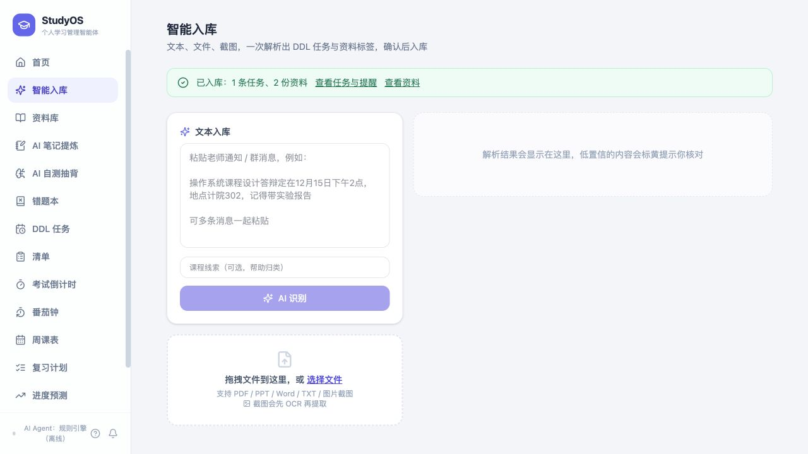

# Agent 入库流程增强与检查记录

日期：2026-10-03（Asia/Shanghai）。范围：现有 Web 与 Mobile 前端的智能入库、首页快捷识别、建议确认及接口错误处理。

## 已完成的改进

| 问题 | 最终行为 |
| --- | --- |
| 修改一份资料的标签会改动全部建议 | 仅修改目标行；允许连续输入逗号再输入新标签；提交时去空值、去重 |
| 连续点击、快捷键或拖拽可能并发解析 | 两个入口共用请求控制 hook，以同步锁限制同时只运行一次解析 |
| 旧请求可能覆盖新结果，确认表单可能沿用上一轮编辑 | 取消请求并检查请求身份；待确认时锁住新解析入口，放弃结果后卸载旧表单再重新识别 |
| 解析等待缺少反馈 | 页面显示解析状态，支持取消；超过两分钟中止浏览器请求并提示重试 |
| 低置信只显示徽章 | 选中的低置信任务/资料需要逐项勾选已核对；任务可查看来源原文，资料可查看摘要 |
| 缺少集中提交校验 | 拦截空选择、空标题、无效截止时间及本批次完全重复条目；不同课程、截止时间、章节保留为独立条目 |
| 无效日期显示 NaN 或自动滚到别的日期 | 拦截无效日期、非闰年 2 月 29 日、日期溢出、夏令时缺失的本地时刻；有效时间转 UTC 提交 |
| 提交期间仍能编辑或重复提交 | 同步提交锁和成功标记防止重复提交；请求进行中锁住表单和放弃按钮，首页弹窗关闭也受限制 |
| 入库成功提示立即消失 | 保留入库数量回执与任务/资料跳转入口；刷新课程候选，保留课程线索供下次录入 |
| 网络或服务端异常后容易误重试 | 不自动重试写入；无法确认结果时提示先检查列表，避免再次创建 |
| 结构化接口校验错误显示不清 | 展示字段路径和错误文本，保留 HTTP 状态与 Retry-After 信息 |
| 文件选择缺少基础校验 | 检查空文件和支持的扩展名；多文件拖拽明确提示一次选择一份 |

本轮没有更改 `/api/agent/extract`、`/api/materials/upload`、`/api/agent/apply` 的请求体约定。新增取消信号属于浏览器请求选项。确认标记等界面字段不会发送到服务端。

## 检查结果

1. Web 和 Mobile 各有 **29 项自动测试通过**：23 项数据/日期/标签/提交校验测试与 6 项接口请求测试。
2. 日期测试在上海、UTC、洛杉矶时区执行；最终完整测试分别在上海和洛杉矶时区通过，另有独立的夏令时缺失时刻测试。
3. 两端 TypeScript 检查、Vite 生产构建、Service Worker 构建通过；最终输出已更新至各自 `dist`。
4. 通过隔离的本机模拟接口完成实际浏览器检查：标签修改隔离、逗号连续输入、低置信拦截、提交时锁定表单、成功回执、取消后重新解析、放弃后重置表单、移动端空选择拦截与单份资料提交。
5. 读取模拟服务收到的请求，确认被拦截的低置信提交没有写入；Web 成功批次的两份资料分别携带 `[内存, 考点]` 和 `[进程]`，Mobile 单份提交只有选择的第二份资料。截止时间提交为正确 UTC 时刻。
6. 两端 agent 工具函数、请求 hook、确认表单和测试文件完全一致，入库页面保留各端原有布局类名。

测试入口（使用已验证的 Node.js 24 环境，无新增依赖）：

```bash
cd web
npm test
npm run build
```

Mobile 在 `mobile` 目录运行同样命令。

## 验证边界

当前 `backend` 目录缺少 `app`、`tests`、`scripts` 和 Python 虚拟环境；本机 `:8800` 也没有可连接的后端。因此本轮无法修改或验证模型抽取、数据库事务、真实 OCR、提醒调度、服务端去重与离线规则引擎。旧 pytest 缓存仅说明曾存在测试，不代表当前源码可运行。

取消解析会中止浏览器等待。服务端是否停止推理、是否清理上传的临时文件，需要恢复后端源码后检查。当前去重覆盖本批次，跨批次、跨设备或连接中断后的幂等仍需服务端支持。

构建仍有大文件提示：主要应用包约 666–667 kB，PPT 预览模块约 1.25 MB（压缩前）。可进一步按页面拆包、按需加载预览模块。

## 后续建议与优先级

| 优先级 | 增强方向 | 可交付行为与验收重点 |
| --- | --- | --- |
| P0 | 恢复后端源码并检查真实闭环 | 同一条通知从抽取、确认、落库到提醒均可回归；检查模型失败、规则降级和事务回滚 |
| P0 | 服务端幂等与跨批次去重 | 每次确认绑定唯一请求 ID；重复发送返回同一回执；按文件哈希和任务身份识别已存在项，支持用户选择合并 |
| P1 | 截止日期变更识别 | “报告延期到下周三”关联原任务，显示变更前后日期，确认后更新任务及提醒 |
| P1 | 跨模块对话助手 | “根据周五考试安排今晚复习”调用检索、任务、复习与专注工具；展示执行计划、依据和待确认变更 |
| P1 | 操作记录与撤销 | 每次 Agent 操作保存批次、来源和变更内容；撤销只恢复该批次且未被后续编辑覆盖的记录 |
| P1 | 动态复习重排 | 依据未完成复习块、专注时长、自测结果和课表空档生成调整建议，解释为什么调整 |
| P2 | 草稿与批量队列 | 可恢复未提交草稿；多文件逐个解析并逐批确认，单份失败不阻塞其他文件 |
| P2 | 抽取评测与诊断 | 固定中文时间/OCR/多任务样例库，追踪字段准确率、耗时、降级次数与用户纠正原因 |
| P2 | 共享两端逻辑与首屏减负 | 将重复 agent 代码移到共享模块，按页面拆包，避免以后只修好其中一端 |


