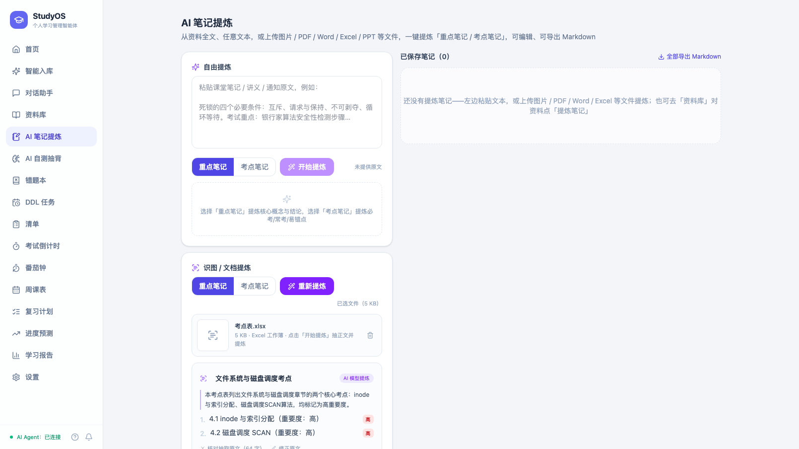
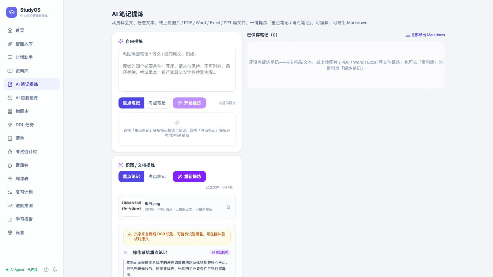

# AI 笔记提炼强化（第四轮）：PDF / Word / Excel 等文件直接提炼

本轮（2026-10-08）把「AI 笔记提炼」从「粘贴文本 / 上传图片」扩展到**直接上传学习文件**：
PDF 讲义、Word 笔记、Excel 复习提纲、PPT 课件、ODT/电子书/纯文本/压缩包都能提炼，
图片（板书照片、课件截图）与文档**共用同一条抽取管线**。

- 后端回归 **655 项**通过（本轮新增 23 项，另有 6 项识图用例改为共用管线）；Web / Mobile 各 **83 项**通过（新增 6 项），双端生产构建成功。
- 真实文件实测：PDF / Word / Excel / 板书照片四条路径 + 拒绝路径（音视频、未知类型、空文档、扫描件降级）。
- GUI 端到端复核：Excel 直接提炼 → 保存为笔记；PNG 板书 OCR 提炼（见文末截图）。

---

## 1. 为什么是「复用」而不是「再写一套解析」

资料入库（`backend/app/ingest/`）已经有一整套「内容嗅探 + 有界解析 + 中文可操作提示」：
110 个扩展名、12 个分组，PDF/Word/Excel/PPT/ODF/电子书/文本/压缩包各自的抽取器，
扫描版 PDF 自动栅格化 OCR。笔记提炼再写一套只会让两条链路的支持范围与提示口径漂移。

因此本轮只做三件事：

1. 在 `formats.py` 登记「提炼可直传的格式集合」（`refine_specs` / `refine_accept_string`）；
2. 在 `notes.py` 增加一个入口，把「落盘 → 嗅探 → 抽取」接到既有提炼管线上；
3. 前端把识图面板升级成文件面板，可选格式由接口派生。

**新增一种格式时，笔记侧零改动**——登记一行即可同时出现在资料入库与笔记提炼两个入口。

---

## 2. 接口契约：`POST /api/notes/refine-file`

multipart：`file`（必填）、`mode`（`keypoints` 重点 / `exam` 考点，默认 keypoints）、
`title_hint`（可选，默认取**去掉扩展名的文件名**）。

流程：`落盘（边读边卡上限）` → `formats.detect_format(file_name, path=临时文件)` →
`files.extract_file()` → `agent/refine.refine()`（LLM 优先、离线规则降级）→ 回包。
**只计算不落库**：用户确认后由 `POST /api/notes` 保存。

### 2.1 体积与安全上限

| 项 | 上限 | 说明 |
| --- | --- | --- |
| 文档（PDF/Office/文本/压缩包…） | **50MB** | 边读边判，超限 413 且不留残文件 |
| 图片 | **20MB** | 与 `/refine-image` 同一条线（OCR 前要整图解码） |
| 图片像素 | 单边 ≤12000px、总像素 ≤5000 万 | 复用 `ingest/imagecheck.py`，防解压炸弹（413） |
| 压缩包 | 条目数 × 单条体积 × 解压总量三重上限 | 复用 `ingest/archive.py`，嵌套包只展开一层 |
| 回传原文 | 2 万字（`source_text`） | 超出时 `truncated=true`，`text_chars` 仍是全文实际字数 |

### 2.2 响应

```json
{
  "title": "文件系统与磁盘调度考点",
  "summary": "……",
  "points": [{ "point": "……", "importance": "high" }],
  "mode": "exam",
  "engine": "llm",
  "source_text": "抽取出的原文（≤2 万字，供核对 / 修正 / 切换模式重新提炼）",
  "ocr_available": true,
  "source_kind": "document",
  "file_name": "考点表.xlsx",
  "file_ext": ".xlsx",
  "format_label": "Excel 工作簿",
  "format_group": "sheet",
  "format_group_label": "表格",
  "text_chars": 64,
  "truncated": false,
  "warnings": []
}
```

- `file_ext` / `format_label` 来自**内容嗅探**（不是扩展名）：改名成 `.ppt` 的 PPTX 会回
  `.pptx` + 「PowerPoint 演示文稿」，并在 `warnings` 里说明「扩展名与实际内容不一致，已按实际格式解析」。
- `warnings` 汇总抽取链路的提示：扫描版 PDF 走了 OCR、原文被截断、OCR 结果可能有误差等，前端逐条以琥珀色提示渲染。
- `source_kind` 区分 `image`（OCR 通道）与 `document`（文本抽取通道），前端据此切换阶段文案（「OCR 识别中…」/「文件解析中…」）。

### 2.3 拒绝路径（422 / 413）都给下一步动作

| 情形 | 状态 | 提示要点 |
| --- | --- | --- |
| 音视频（.mp3/.mp4…） | 422 | 本机不联网、无语音识别 → 可上传配套课件，或把文字粘贴进来 |
| 认不出的类型（.bin…） | 422 | 转成 PDF/TXT 后重试 |
| 空文档（空段落 / 空表） | 422 | 可能是空文件或正文都是图片 |
| 扫描版 PDF 且 OCR 不可用 | 422 | 「这份 PDF 没有文本层」，换文字版或粘贴文本 |
| 图片 OCR 不可用 / 无文字 | 422 | 换更清晰的图片，或直接粘贴文本 |
| 超大文件 / 像素炸弹 | 413 | 压缩后重试 / 缩小尺寸 |
| 模式非法 | 422 | 可选 keypoints/exam |

### 2.4 `/refine-image` 保持兼容

`POST /api/notes/refine-image` 现在是 `refine-file` 的**图片专用入口**：上传文档会回
「识图提炼只支持图片文件…PDF / Word / Excel 等文档请用「文档提炼」」，其余行为
（20MB 上限、像素校验、OCR 未就绪指引、文件名兜底标题）与改造前一致，老前端与外部调用方不受影响。
两者共用同一份实现（`_refine_upload`），因此不会再出现「识图这边修了、文档那边还是旧口径」。

---

## 3. 「可提炼的格式」是接口派生的一等公民

- 后端 `formats.refine_specs()`：登记表里 `supported=true`、分组不属于 `REFINE_EXCLUDED_GROUPS`
  （`media` 音视频 / `other` 未知）、且本机解码器可用的格式。
- `GET /api/ingest/formats` 新增字段 **`refine_accept`**（当前 82 个扩展名），前端 `<input accept>` 直接用它；
  它是**唯一事实来源**，与 `/refine-file` 的实际能力一一对应。
- 前端 `lib/formats.ts` 新增 `refineAcceptFromCatalog / refineGroups / refineSummaryText / isRefinableFile`：
  - 接口的 `refine_accept` 必须落在 `supported=true` 的格式内（HEIC 缺解码器时自动剔除，避免「可选却必然报错」）；
  - 接口不可用时回落到**提炼专用兜底目录** `refineFallbackCatalog()`（在上传兜底目录基础上补齐 Excel/CSV/EPUB 等），
    保证「PDF / Word / Excel / PPT / 图片」这些主推能力不会因为一次请求失败就从界面上消失；
  - 选文件前先按 accept 拦一次，并按原因给中文提示（`refineRejectReason`）：本机缺解码器（HEIC → 先转 JPG/PNG）、音视频（无法离线转写 → 上传配套课件或粘贴文字）、其余（先转 PDF/TXT）；无扩展名的文件放行给后端按内容嗅探。

---

## 4. 前端：`ImageRefinePanel` → `FileRefinePanel`

Web 与 Mobile 双端同源（`FileRefinePanel.tsx` 两处内容一致，仅页面外壳样式不同）：

- **选择**：点击 / 拖拽 / Ctrl+V 粘贴截图（图片）；文档走点击或拖拽。
- **预览**：图片显示缩略图；文档按分组显示图标（表格 / 演示 / 压缩包 / 通用）+ 文件名 + 体积 +
  **后端嗅探出的中文格式名**（如「Excel 工作簿」）。
- **阶段文案**：前 2 秒显示「OCR 识别中…」或「文件解析中…」，之后「AI 提炼中…」；OCR 模型首次加载
  导致的 503 会自动延迟重试（最多 3 次）。
- **结果区**：抽取提示逐条展示；标题可改；要点带重要度；**核对抽取原文**（展开 2 万字原文）、
  **修正原文**（改完用修正文本重新提炼）；切换重点/考点模式直接用已有原文重新提炼，不重复上传与识别；
  原文被截断时明确提示「原文共 N 字，仅回传前 2 万字供核对」。
- **保存**：`POST /api/notes` 落库，右侧「已保存笔记」列表即时刷新。

---

## 5. 证据

后端用例（`backend/tests/test_notes_file.py`，21 项 + 格式登记 3 项 + 识图适配）覆盖：
PDF 文本层、Word、Excel、PPT、纯文本/Markdown、CSV、图片 OCR、保存为笔记无副作用、
扩展名纠正（.ppt→.pptx）、超长原文截断、标题提示与文件名兜底、音视频/未知类型/空文档/扫描件降级、
体积与像素上限、模式校验。

GUI 端到端（真实后端 + 真实 LLM + 真实 OCR）：

| 文档提炼（Excel） | 识图提炼（PNG 板书，含 OCR 提示） |
| --- | --- |
|  |  |

复核命令（示例）：

```bash
# 文档
curl -X POST http://127.0.0.1:8800/api/notes/refine-file \
  -F "file=@考点表.xlsx" -F "mode=exam"
# 图片（等价通道）
curl -X POST http://127.0.0.1:8800/api/notes/refine-file \
  -F "file=@板书.png" -F "mode=keypoints"
# 拒绝路径：音视频 → 422；文档走识图入口 → 422（提示改用文件提炼）
```

---

## 6. 已知边界

- **音视频不转写**：本机不联网、也不内置语音识别，`.mp3/.mp4` 等一律 422 并给替代做法（上传配套课件或粘贴文稿）。
- **同步阻塞**：抽取与 OCR 在请求内完成（上限 50MB / 扫描件 OCR 前 10 页）。超大讲义建议先拆分，
  或走「资料入库」上传后在资料卡片上点「提炼笔记」（同一条提炼管线）。
- **原文截断**：回传原文 2 万字用于核对，超出部分不参与模式切换时的重新提炼（`truncated` 会提示）；
  首次提炼仍使用全文（LLM 侧按 `agent/refine.py` 的既有窗口截取）。
- **图片体积另算**：文档上限放宽到 50MB 不影响图片的 20MB 与像素上限——那是 OCR 前的防 OOM 线。
